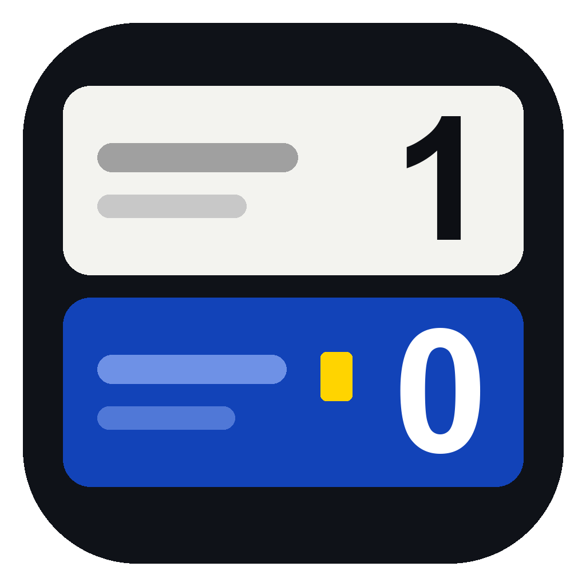

# Judo-Anzeigetafel

Anzeigetafel für Judo-Wettkämpfe – für Windows und macOS, **ohne Installation**.

- **Publikumsanzeige** im Vollbild auf dem zweiten Bildschirm/Beamer (erweiterter Desktop)
- **Bedienfenster** auf dem Laptop mit Live-Vorschau der Anzeige
- Namen optional, manuell oder per **Excel-Import**
- **Regelprofile** pro Altersklasse (Kampfzeit, Golden Score, „Ippon beendet den Kampf“ ja/nein, Yuko, Shido-Grenze, Osaekomi-Zeiten …)



## Download & Start

Die fertigen Dateien liegen unter **Releases** (bzw. als Artefakt jedes Builds unter **Actions**).

| System | Datei | Start |
|---|---|---|
| Windows | `Judo-Anzeigetafel-x.y.z-Windows-portable.exe` | Doppelklick. Keine Installation. |
| Windows | `Judo-Anzeigetafel-x.y.z-Windows.zip` | Entpacken, `Judo-Anzeigetafel.exe` starten (startet schneller als die portable .exe). |
| macOS (Apple Silicon + Intel) | `Judo-Anzeigetafel-x.y.z-Mac.zip` | Entpacken, `Judo-Anzeigetafel.app` starten. |

**Hinweise beim ersten Start** (die App ist nicht kostenpflichtig signiert):

- **Windows:** „Der Computer wurde durch Windows geschützt“ → *Weitere Informationen* → *Trotzdem ausführen*.
- **macOS:** Meldung „kann nicht geöffnet werden“ → *Systemeinstellungen → Datenschutz & Sicherheit* → ganz unten *Dennoch öffnen*.
  Alternativ im Terminal: `xattr -cr /Pfad/zu/Judo-Anzeigetafel.app`

Die portable Windows-Version speichert ihre Daten im Ordner `Judo-Anzeigetafel-Daten` neben der .exe – sie läuft also auch vom USB-Stick.

**Notbetrieb ohne App:** Quellcode herunterladen und `src/control.html` in Chrome oder Edge öffnen. „Anzeige öffnen“ öffnet das Publikumsfenster (Pop-ups erlauben), dieses auf den Beamer ziehen und doppelklicken (Vollbild).

## Bedienung

1. App starten – die Anzeige öffnet sich automatisch im Vollbild auf dem zweiten Bildschirm (ist keiner angeschlossen: als Fenster). Oben rechts kann der Bildschirm gewechselt werden.
2. Namen eintragen (optional) oder Kampfliste laden, *Hajime* drücken.
3. Nach dem Kampf *Nächster Kampf* (Taste `N`) – das Ergebnis landet automatisch im Protokoll.

### Tastenkürzel

| Taste | Aktion |
|---|---|
| `Leertaste` | Hajime / Mate (nach Zeitende bei Gleichstand: Golden Score starten) |
| `A` / `L` | Osaekomi Weiß / Blau (nochmal drücken = Toketa) |
| `T` | Toketa |
| `Q` `W` `E` `R` | Weiß: Ippon, Waza-ari, Yuko, Shido |
| `U` `I` `O` `P` | Blau: Ippon, Waza-ari, Yuko, Shido |
| `Shift` + Wertungstaste | Wertung abziehen |
| `↑` / `↓` | Uhr ±1 Sekunde |
| `Strg/⌘ + Z` | Rückgängig |
| `N` | Nächster Kampf |
| `B` | Pausenbild (Turniername, Logo, nächste Kämpfe) an/aus |

Im Anzeigefenster: Doppelklick oder `F` = Vollbild an/aus.

### Was die Tafel automatisch macht

- Kampfzeit, Golden Score (optional mit Höchstdauer → danach Kampfrichterentscheid)
- Osaekomi-Uhr mit automatischer Wertung (Standard: 5 s Yuko, 10 s Waza-ari, 20 s Ippon), läuft nach Zeitende weiter
- 2× Waza-ari = Ippon, 3. Shido = Hansoku-make (abschaltbar)
- Sieger nach Zeitende über die Wertungen; große Einblendung der Wertung auf der Anzeige
- Gong bei Zeit- und Kampfende (wahlweise am Bedienrechner oder über die Anzeige)
- Manuelle Entscheidungen: Hantei, Kiken-gachi, Fusen-gachi, Disqualifikation, Unentschieden
- Alles wird laufend gespeichert und nach einem Absturz/Neustart wiederhergestellt

## Excel-Import

Im Reiter **Kampfliste** gibt es *Excel-Vorlage speichern*. Die Vorlage hat zwei Blätter – eines reicht:

- **Kampfliste** – fertige Paarungen: `Nr`, `Altersklasse`, `Gewichtsklasse`, `Weiß Name`, `Weiß Verein`, `Blau Name`, `Blau Verein`
- **Teilnehmer** – nur Namen: `Vorname`, `Nachname` (oder `Name`), `Verein`, `Altersklasse`, `Gewichtsklasse`.
  Daraus erzeugt die App pro Gruppe „Jeder gegen jeden“.

Die Spalten werden an den Überschriften erkannt, die Reihenfolge ist egal. CSV geht auch.
Die **Altersklasse** wählt beim Laden eines Kampfes automatisch das passende Regelprofil (Name oder Alias, z. B. „U12, U13“).

## Regelprofile

Unter **Einstellungen → Regelprofile**. Mitgeliefert: U11, U13, U15, U18, Erwachsene, Masters.
Die Kampfzeiten sind Vorschläge – bitte mit der jeweiligen Ausschreibung abgleichen.
Für U11/U13 ist „Ippon beendet den Kampf“ ab Werk ausgeschaltet; es zählt dann die Anzahl der Wertungen nach Ablauf der Zeit.

## Entwicklung

```bash
npm install
npm start        # App starten
npm test         # Tests der Wettkampflogik und des Excel-Imports
```

Aufbau:

- `main.js` – Electron-Hauptprozess (Fenster, Bildschirme, Vollbild)
- `src/js/core.js` – Wettkampfregeln, ohne Oberfläche, mit Tests in `test/`
- `src/js/render.js` + `src/css/board.css` – Anzeigetafel (auch als Vorschau im Bedienfenster)
- `src/js/control.js` – Bedienfenster
- `src/js/excel.js` – Import/Export (SheetJS liegt lokal in `src/vendor/`, funktioniert offline)

### Neue Version veröffentlichen

```bash
git tag v1.0.1
git push origin v1.0.1
```

GitHub Actions baut dann Windows- und Mac-Version und hängt sie an ein neues Release.

## Hinweis

Diese App wurde mit Unterstützung von KI (Claude, Anthropic) entwickelt.

## Lizenz

MIT – siehe [LICENSE](LICENSE).
