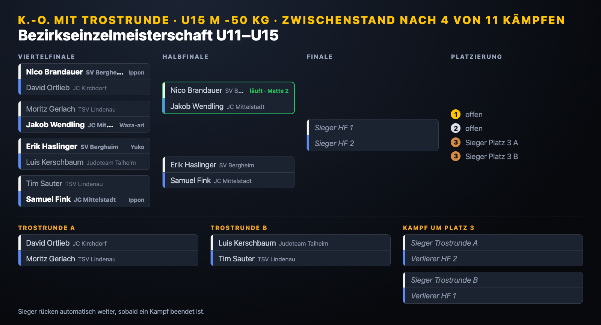
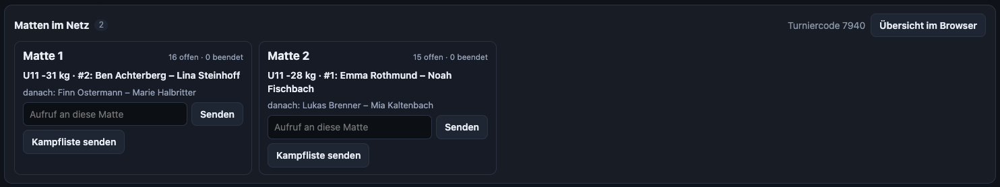

#  Hajime

**Judo-Anzeigetafel** für Training, Vereinsmeisterschaft und Turnier – kostenlos, **ohne Installation** und **ohne Internet**. Für **Windows**, **macOS** und als **Webversion** für jeden Rechner mit Chrome oder Edge.

> **Du musst nicht alles nutzen.** Hajime ist zuerst eine ganz normale Anzeigetafel: Uhr, Wertungen, Shido, Osaekomi. Namen, Excel-Listen und Turnierfunktionen sind Zusatzangebote.

**📖 [Schnellstart](docs/schnellstart.md)** – in fünf Minuten zur Anzeigetafel
**📘 [Benutzerhandbuch](docs/benutzerhandbuch.md)** – alles Schritt für Schritt, auch für Leute ohne IT-Erfahrung

| Bedienung auf dem Laptop | Anzeige auf dem Beamer |
|---|---|
|  |  |

## Download

Unter [**Releases**](../../releases/latest):

| Rechner | Datei | Start |
|---|---|---|
| **Windows** 10/11 | `Hajime-x.y.z-Windows.zip` | Entpacken, **Hajime starten** doppelklicken |
| **macOS** (Apple Silicon + Intel) | `Hajime-x.y.z-Mac.zip` | Entpacken, `Hajime.app` starten |
| **Webversion** (Chrome/Edge) | `Hajime-x.y.z-Web.zip` | Entpacken, `Hajime starten.html` öffnen |

Einzelheiten, auch zu Meldungen von Windows und macOS beim ersten Start: [Herunterladen und starten](docs/benutzerhandbuch.md#herunterladen-und-starten).

## Funktionen

Beim ersten Start wählst du den Umfang – **Einfach**, **Standard** oder **Turnier**. Ändern lässt er sich jederzeit.

**Anzeigetafel** (alle Stufen)

- Publikumsanzeige im Vollbild auf Beamer oder zweitem Bildschirm, Bedienung auf dem Laptop mit Vorschau
- Regelprofile pro Altersklasse (Kampfzeit, Golden Score, Ippon beendet ja/nein, Yuko, Shido-Grenze, Osaekomi-Zeiten)
- Golden Score, Osaekomi-Uhr, 2 × Waza-ari und 3. Shido werden automatisch ausgewertet; Rückgängig für alles
- Trainingsuhr für Randori mit Runden, Pausen und Vorlagen
- Bedienung und Anzeige getrennt auf Deutsch oder Englisch

**Namen und Kampfliste** (ab *Standard*)

- Namen von Hand oder per Excel-Import, nächster Kampf auf der Anzeige, Pausenbild
- Aushang zum Ausdrucken, Protokoll mit Ereignissen, Export nach Excel
- Mannschaftskampf mit Aufstellung, Mannschaftsstand und Ergebnisbogen

**Turnier** (Stufe *Turnier*)

- Turniersysteme: Best of Three, Jeder gegen jeden, Doppel-Pool, K.-o. mit Trostrunde – mit Vereinstrennung, Sieger rücken automatisch nach
- Gruppen auf mehrere Matten verteilen, auf Wunsch nach Geschlecht getrennt
- **Matten im Netz:** Die Laptops verbinden sich im WLAN, Ergebnisse laufen automatisch zur Turnierleitung, Übersicht aller Matten auch im Browser
- Gruppentabellen (Punkteschema DJB, IJF oder eigene Werte) und Turnierbäume, auch groß auf der Anzeige
- Siegerliste und Urkunden als PDF, Kämpfer aufrufen, Ruhezeit-Warnung

| Gruppentabelle | Turnierbaum | Matten im Netz |
|---|---|---|
|  |  |  |

Weitere Bilder stehen im [Benutzerhandbuch](docs/benutzerhandbuch.md). Alle Namen in den Bildern sind erfunden (aus der [Beispiel-Excel](beispiel/Beispiel-Teilnehmer-20.xlsx)).

## Datenschutz

Hajime braucht kein Internet und sendet keine Daten an Dritte. Alles bleibt auf dem eigenen Rechner. Netzwerkverbindungen gibt es nur, wenn du sie einschaltest: *Matten im Netz* verbindet Hajime-Rechner im selben lokalen Netz; der Link im Fenster *Über Hajime* öffnet GitHub im Browser.

## Entwicklung

```bash
npm install
npm start                       # Electron-App starten
npm test                        # Tests (Wettkampflogik, Turniersysteme, Matten, Excel, Training, Mannschaft, Netz, Windows, Sprachen)
npm run build:web               # Webversion nach dist/Hajime-Web
node scripts/build-windows.js   # Hajime für Windows nach dist/Hajime-x.y.z-Windows (ohne node.exe; die CI legt sie dazu)
node windows/hajime-windows.js --foreground   # Hajime für Windows auf jedem System ausprobieren (http://127.0.0.1:47811)
HAJIME_SCREENSHOTS=docs/screenshots npx electron .     # Screenshots für Handbuch und README
npx electron scripts/screenshots-netz.js docs/screenshots   # Screenshots „Matten im Netz“ und Windows-Darstellungen
```

Aufbau:

- `main.js`, `preload.js` – Electron (macOS-App): Fenster, Bildschirme, Vollbild, Menü
- `windows/` – **Hajime für Windows**: `hajime-windows.js` liefert die Seiten an Edge aus und ist die Brücke für Zentrale, Suche und Firewall-Freigabe (`netsh`); `native.js` ist die Gegenseite im Fenster; `Hajime starten.cmd` startet die signierte `node.exe` von nodejs.org
- `hub.js` – Zentrale für Matten im Netz (HTTP/WebSocket) und Suche nach der Zentrale, reines Node.js
- `src/js/core.js` – Wettkampfregeln; `brackets.js` Turniersysteme; `mats.js` Verteilung auf Matten; `net.js` Matten im Netz; `team.js` Mannschaftskampf; `training.js` Trainingsmodus – alles ohne Oberfläche, mit Tests in `test/`
- `src/js/control.js` – Bedienfenster; `render.js` + `src/css/board.css` – Anzeigetafel; `transport.js` – Verbindung der Fenster (Electron-IPC oder Pop-up + `postMessage`)
- `src/js/excel.js`, `notice.js`, `awards.js`, `bracketview.js` – Excel, Aushang, Siegerliste/Urkunden, Turnierbaum
- `src/js/i18n.js` + `src/lang/*.js` – Sprachen; `node scripts/i18n-keys.js` listet fehlende Übersetzungen
- `scripts/build-web.js`, `scripts/build-windows.js` – Webversion und Windows-Paket; `scripts/windows-smoketest.js` – Starttest unter Windows in der CI

**Weitere Sprache:** `src/lang/en.js` kopieren (z. B. `fr.js`), Kürzel und Namen in der ersten Zeile ändern, rechte Seite übersetzen, in `src/control.html` und `src/board.html` nach `lang/en.js` eintragen. Übersetzungen gern als Pull Request.

### Neue Version veröffentlichen

Version in `package.json` setzen, dann:

```bash
git tag vX.Y.Z
git push origin vX.Y.Z
```

GitHub Actions baut Mac-, Windows- und Webversion, startet sie zur Probe und hängt sie an ein neues Release. Für Windows lädt die CI die aktuelle LTS-Version von `node.exe` direkt von nodejs.org und prüft Prüfsumme und Signatur.

## Geplante Funktionen

Ideen und Wünsche stehen unter [Issues](https://github.com/junky84/hajime/issues), die Zuordnung zu den nächsten Versionen unter [Meilensteine](https://github.com/junky84/hajime/milestones).

## Hinweis

Diese App wurde mit Unterstützung von KI (Claude, Anthropic) entwickelt.

## Lizenz

MIT – siehe [LICENSE](LICENSE).

Die Schrift VT323 im Fenster *Über Hajime* steht unter der SIL Open Font License 1.1 – siehe [src/fonts/VT323-OFL.txt](src/fonts/VT323-OFL.txt). Hajime für Windows enthält Node.js (MIT-Lizenz, [nodejs.org](https://nodejs.org)).
