#  Hajime

**Judo-Anzeigetafel** für Training, Vereinsmeisterschaft und Turnier – **ohne Installation**: als **Webversion** für jeden Rechner mit Chrome oder Edge (läuft offline, keine Programmdatei) und als **App für macOS** und **Windows** (signiert, siehe [Code signing policy](#code-signing-policy)).

> **Du musst nicht alles nutzen.** Hajime ist zuerst eine ganz normale Anzeigetafel: Uhr, Wertungen, Shido, Osaekomi. Namen, Excel-Listen und Turnierfunktionen sind Zusatzangebote. Wer sie nicht braucht, lässt sie einfach weg – die Tafel funktioniert auch ganz ohne Namen.

## In 3 Schritten zur Anzeigetafel

1. Unter [**Releases**](../../releases/latest) die Datei herunterladen und entpacken: `Hajime-x.y.z-Web.zip` für jeden Rechner mit Chrome oder Edge, `Hajime-x.y.z-Mac.zip` für den Mac (Einzelheiten unter [Download & Start](#download--start)).
2. Starten und bei der Frage *„Wie möchtest du Hajime nutzen?“* **Einfach** wählen. Die Anzeige erscheint auf dem Beamer oder zweiten Bildschirm (in der Webversion *Anzeige öffnen* klicken).
3. **Leertaste** drücken = *Hajime*. Wertungen mit der Maus oder per Taste geben, danach *Kampf neu*.

Fertig. Keine Anmeldung, kein Internet, keine Namen nötig. Die Kampfzeit und die übrigen Regeln (z. B. für U11 oder U15) wählst du oben im Feld *Regelprofil*.

| Einfach: Bedienung | Einfach: Anzeige für das Publikum |
|---|---|
| 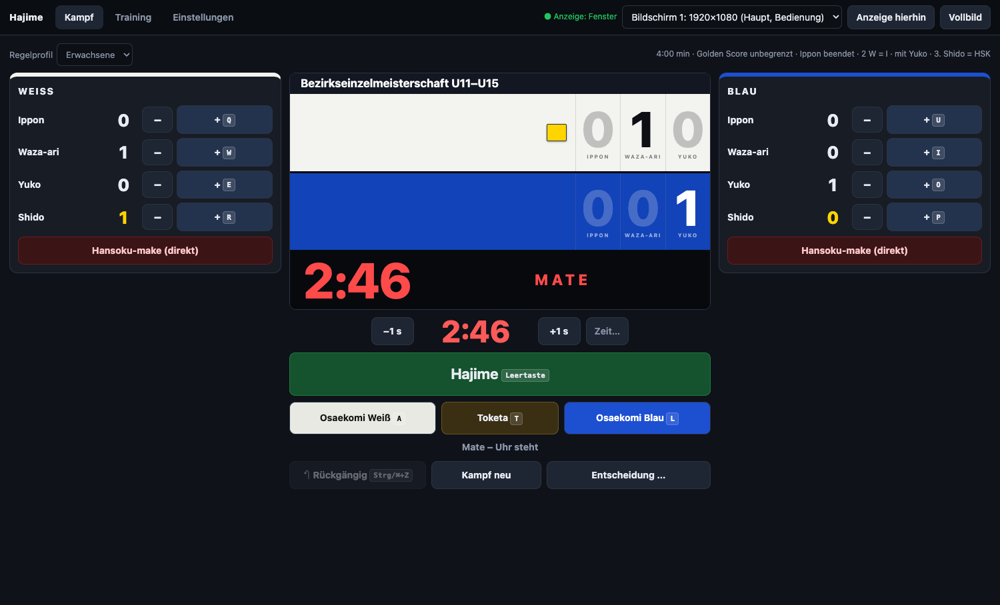 | 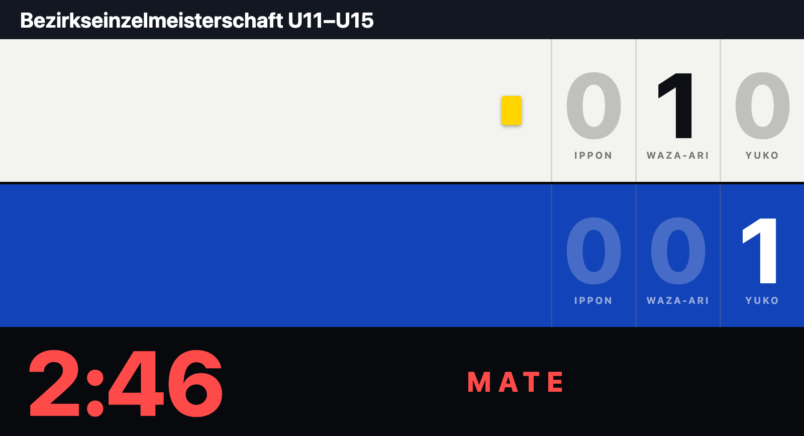 |

## Einfach, Standard oder Turnier

Beim ersten Start fragt Hajime, wie du es nutzen möchtest. Ändern lässt sich das jederzeit unter *Einstellungen → Bedienung → Umfang*. Dabei geht nichts verloren: Kampfliste, Protokoll usw. werden nur ausgeblendet.

| Umfang | Du bekommst … |
|---|---|
| **Einfach** – nur Anzeigetafel | Uhr, Hajime/Mate, Osaekomi, Wertungen, Shido, Rückgängig, Regelprofil, Trainingsuhr. Keine Namen, keine Listen. |
| **Standard** – Kämpfe mit Namen | dazu Namen und Vereine, Kampfliste mit **Excel-Import**, Aushang, Protokoll, Pausenbild und [Mannschaftskampf](#mannschaftskampf) |
| **Turnier** – alles | dazu Turniersysteme, [mehrere Matten](#mehrere-matten), [Matten im Netz](#matten-im-netz), [Auswertung, Siegerliste und Urkunden](#auswertung-und-siegerehrung), Gruppentabelle und Aufruf |

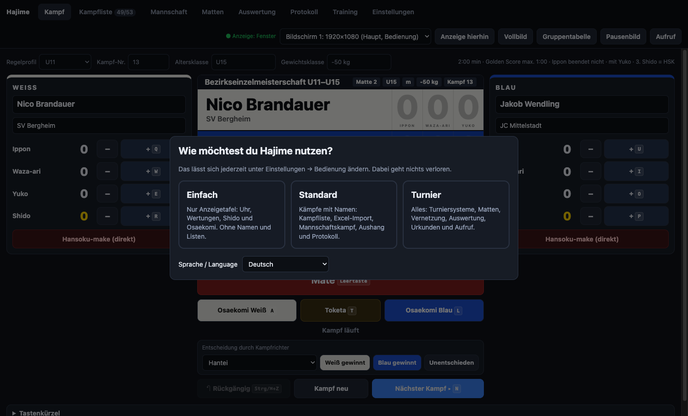

Tastenkürzel bleiben in allen Stufen gleich; Kürzel für ausgeblendete Funktionen (z. B. `G` für die Gruppentabelle) tun dann einfach nichts.

## Alle Funktionen im Überblick

**Anzeigetafel** (alle Stufen)

- **Publikumsanzeige** im Vollbild auf dem zweiten Bildschirm/Beamer (erweiterter Desktop)
- **Bedienfenster** auf dem Laptop mit Live-Vorschau der Anzeige
- **Regelprofile** pro Altersklasse (Kampfzeit, Golden Score, „Ippon beendet den Kampf“ ja/nein, Yuko, Shido-Grenze, Osaekomi-Zeiten …)
- Golden Score, Osaekomi-Uhr, 2× Waza-ari und 3. Shido werden automatisch ausgewertet
- **Trainingsmodus:** Randori-Timer mit Runden, Pausen, Vorlagen, Gong und Signalton ([mehr](#trainingsmodus))
- **Sprachen:** Bedienung und Anzeige getrennt auf Deutsch oder Englisch ([mehr](#sprachen))

**Optional: Namen und Kampfliste** (ab *Standard*)

- Namen von Hand oder per **Excel-Import**
- **Nächster Kampf** gut lesbar unten auf der Anzeige, in drei Größen
- **Ereignisprotokoll** jedes Kampfes und Ergebnis-Export nach Excel (Ippon, Waza-ari, Yuko, Shido je Kämpfer in eigenen Spalten)
- **Aushang** der Kampfreihenfolge pro Matte zum Ausdrucken (A4/A3)
- **Mannschaftskampf** für Liga und Mannschaftsturnier: Aufstellung, Hin- und Rückrunde, Mannschaftsstand auf der Anzeige, Ergebnisbogen ([mehr](#mannschaftskampf))

**Optional: Turnier** (Stufe *Turnier*)

- **Turniersysteme:** Best of Three, Jeder gegen jeden, Doppel-Pool und K.-o. mit Trostrunde – nach Gruppengröße vorgeschlagen, mit Vereinstrennung, Sieger rücken automatisch weiter
- **Mehrere Matten:** Gruppen gleichmäßig verteilen, Mädchen und Jungen möglichst auf eigenen Matten, pro Matte als Excel exportieren
- **Matten im Netz:** Die Rechner der Matten finden eine Zentrale im (W)LAN von selbst, Ergebnisse laufen automatisch zurück, Übersicht aller Matten auch im Browser ([mehr](#matten-im-netz))
- Gruppen auf Wunsch **nach Geschlecht getrennt**
- **Gruppentabellen und Turnierbäume** mit automatischer Platzierung nach **DJB** (Standard), **IJF** oder eigenen Werten, auch groß auf der Anzeige
- **Siegerliste und Urkunden** als PDF (Siegerliste auch als Excel)
- **Ruhezeit-Warnung**, wenn ein Kämpfer seine Mindestpause noch nicht hatte

## Screenshots

**Publikumsanzeige** (Vollbild auf Beamer/zweitem Bildschirm) – die einfache Anzeige ohne Namen steht [oben](#in-3-schritten-zur-anzeigetafel)

| Kampf läuft mit Osaekomi | Kampfende mit Sieger |
|---|---|
|  |  |
| **Golden Score** | **Pausenbild mit den nächsten Kämpfen** |
|  |  |
| **Gruppentabelle** (Taste `G`) | **Turnierbaum** K.-o. mit Trostrunde |
|  |  |
| **Aufrufzeile** oben auf der Anzeige (Taste `K`) | **Trainingsuhr** (Randori mit Runden und Pausen) |
| 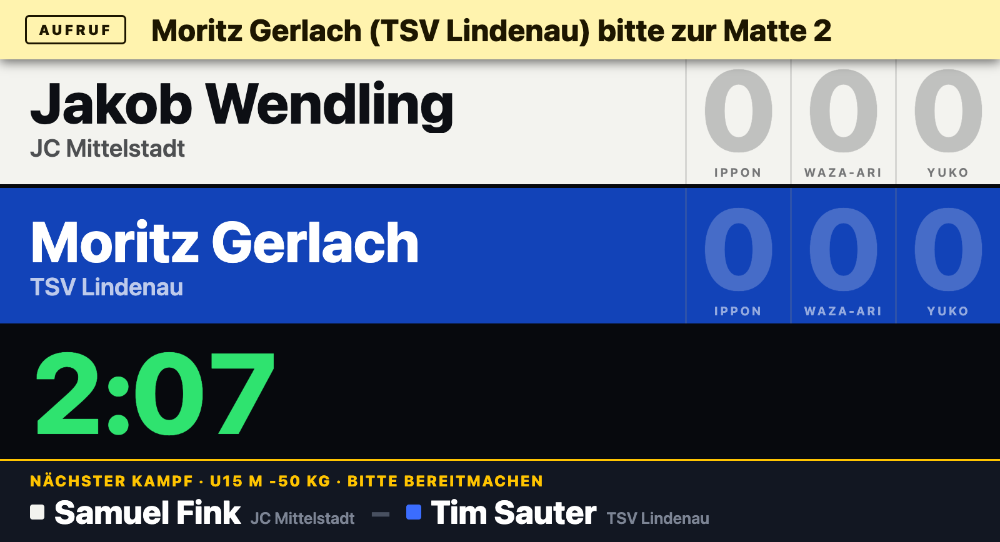 | 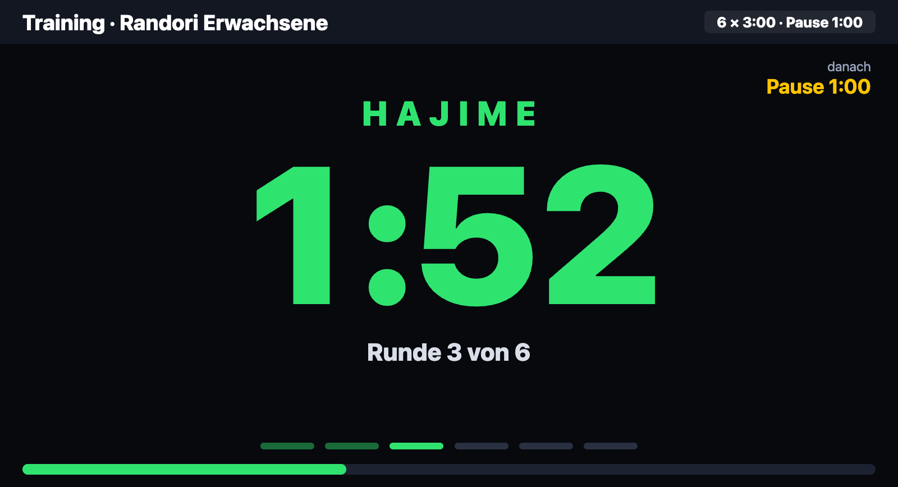 |
| **Mannschaftskampf** mit Mannschaftsstand | |
| 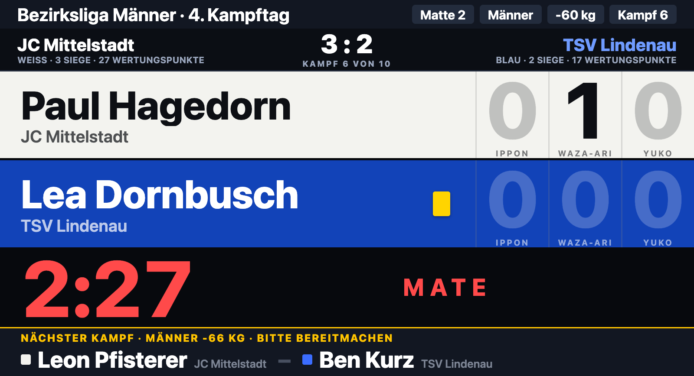 | |

**Bedienfenster** (Laptop)


| Kampfliste & Teilnehmer (Excel-Import, Jeder gegen jeden) | Einstellungen & Regelprofile |
|---|---|
|  |  |
| **Auswertung** (Gruppentabellen, Siegerliste, Urkunden) | **Ruhezeit-Warnung** beim Laden eines Kampfes |
|  |  |
| **Turniersysteme** je Gruppe, nach Geschlecht getrennt | **Auf Matten verteilen** |
| 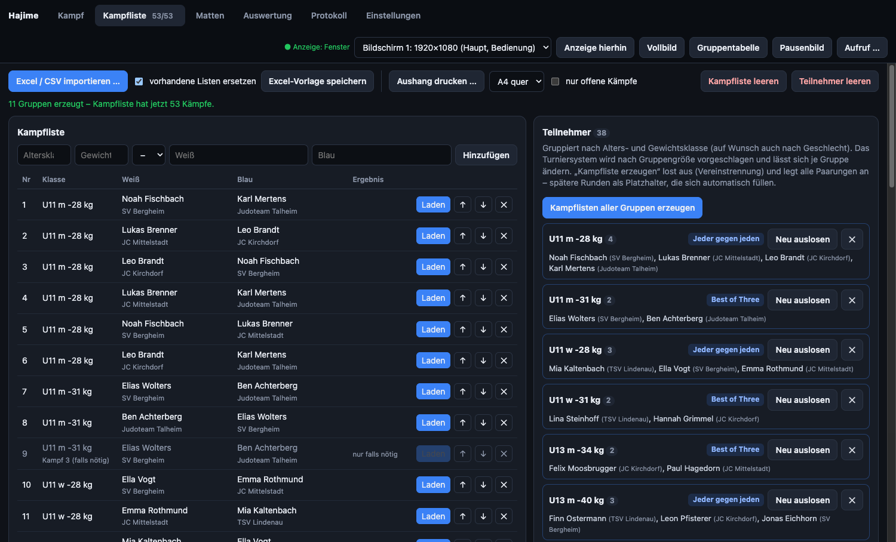 | 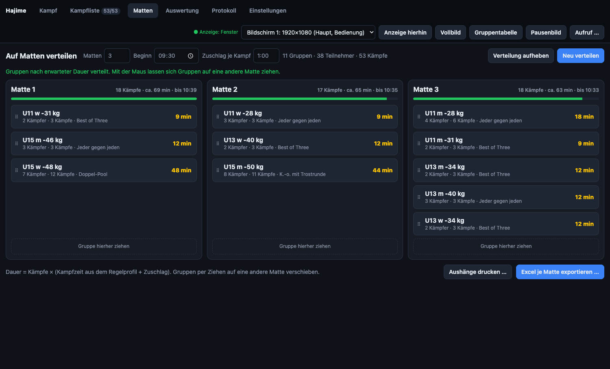 |
| **Turnierbaum** in der Auswertung | **Trainingsmodus** |
| 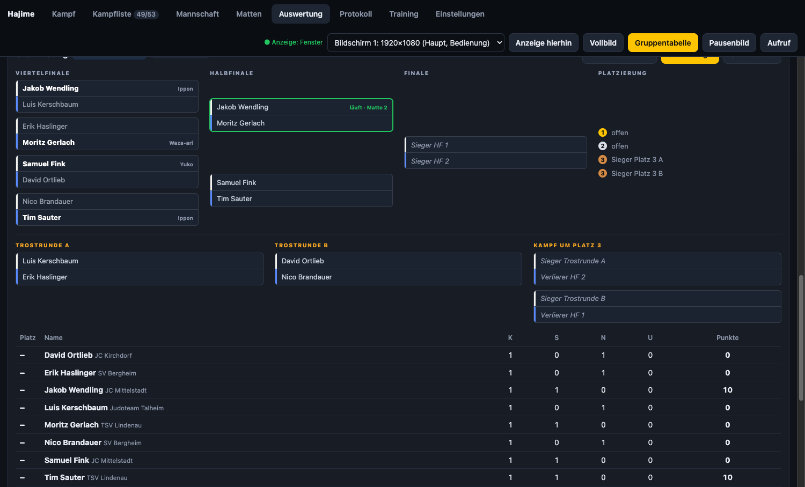 | 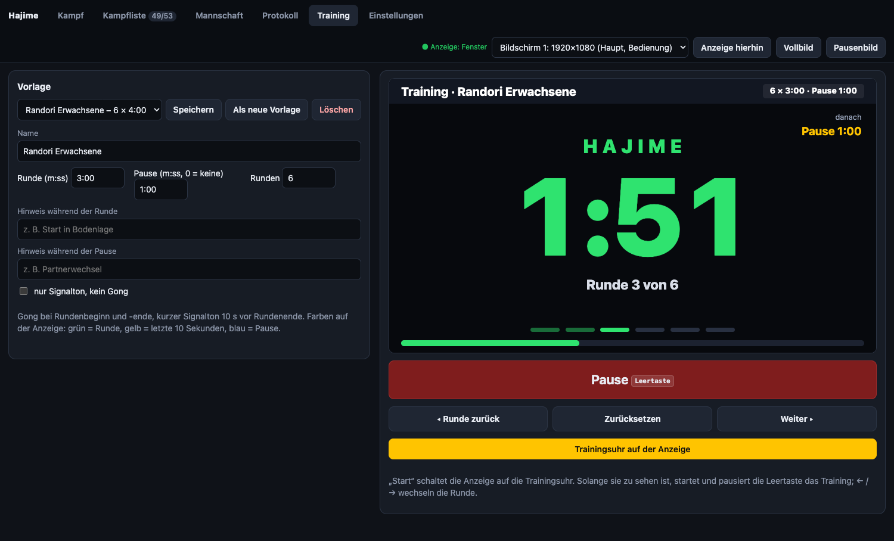 |
| **Mannschaftskampf**: Aufstellung und Ergebnisse | **Bedienung auf Englisch** |
| 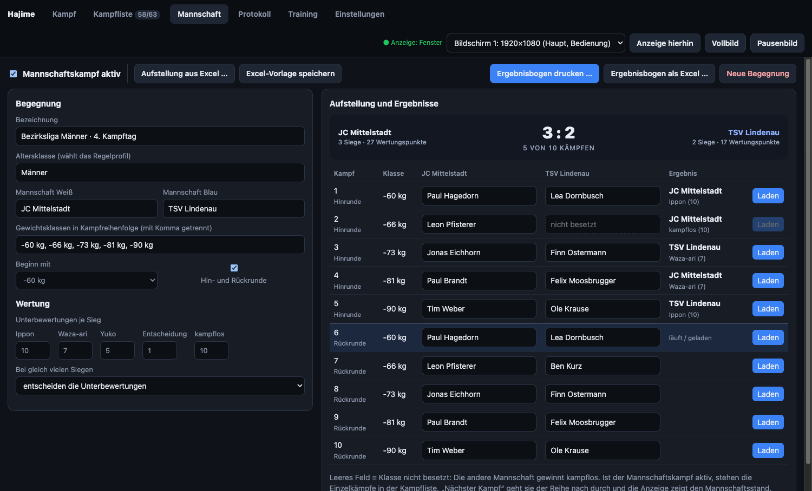 | 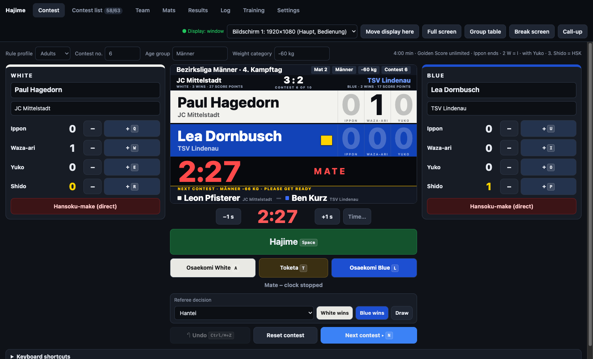 |

**Ausdrucke** (PDF)

| Urkunde | Siegerliste |
|---|---|
|  |  |

Alle Namen in den Screenshots sind erfunden (aus der [Beispiel-Excel](beispiel/Beispiel-Teilnehmer-20.xlsx)).

## Download & Start

Die fertigen Dateien liegen unter **Releases**.

| Version | Datei | Start |
|---|---|---|
| **Webversion** – jeder Rechner mit Chrome oder Edge | `Hajime-x.y.z-Web.zip` | Entpacken, `Hajime starten.html` öffnen. |
| **macOS-App** (Apple Silicon + Intel) | `Hajime-x.y.z-Mac.zip` | Entpacken, `Hajime.app` starten. |
| **Windows-App** (Windows 10/11, 64 Bit) | `Hajime-x.y.z-Windows-portable.exe` oder `Hajime-x.y.z-Windows.zip` | `.exe` direkt starten bzw. ZIP entpacken und `Hajime.exe` starten. |

Die Windows-App erscheint im Release, sobald sie über SignPath signiert ist ([Code signing policy](#code-signing-policy)). Unsignierte Windows-Programme lösen auf vielen Rechnern Virenwarnungen aus; bis dahin ist die Webversion der Weg für Windows.

### Webversion

Dieselbe Anzeigetafel, nur im Browser: keine Installation, keine Programmdatei, **kein Internet nötig**. Ideal für Vereins- oder Leihrechner, auf denen keine fremden Programme laufen dürfen.

1. `Hajime-x.y.z-Web.zip` entpacken und `Hajime starten.html` in **Chrome oder Edge** öffnen.
2. *Anzeige öffnen* klicken und Pop-ups erlauben, falls der Browser fragt.
3. Beim ersten Mal fragt der Browser, ob die Seite **Fenster auf allen Bildschirmen verwalten** darf. Mit *Zulassen* erscheint oben eine Bildschirmauswahl und die Anzeige landet automatisch auf dem Beamer. Ohne Erlaubnis das Fenster von Hand hinüberziehen.
4. Im Anzeigefenster **einmal klicken** (Browser geben den Ton erst nach einem Klick frei – bis dahin steht dort ein roter Hinweis) und **doppelklicken** für Vollbild.

Einstellungen, Kampfliste und Protokoll speichert der Browser. Für einen anderen Rechner unter *Einstellungen* eine Sicherung speichern und dort laden.

**Als Web-App:** Der Ordner kann auch auf einen Webserver gelegt werden. Dann lässt sich Hajime in Chrome/Edge über das Installieren-Symbol in der Adressleiste wie eine App anlegen und läuft nach dem ersten Aufruf offline.

Getestet ist die Webversion mit Chrome/Edge. Firefox und Safari sollten grundsätzlich laufen, können die Anzeige aber nicht selbst auf den zweiten Bildschirm schieben.

### macOS-App

Die App öffnet die Anzeige selbst im Vollbild auf dem zweiten Bildschirm und braucht keinen Klick für den Ton.

**Erster Start** (die App ist nicht kostenpflichtig signiert): Meldung „kann nicht geöffnet werden“ → *Systemeinstellungen → Datenschutz & Sicherheit* → ganz unten *Dennoch öffnen*.
Alternativ im Terminal: `xattr -cr /Pfad/zu/Hajime.app`

## Bedienung

1. Hajime starten. In der **macOS-App** öffnet sich die Anzeige automatisch im Vollbild auf dem zweiten Bildschirm (ist keiner angeschlossen: als Fenster). In der **Webversion** *Anzeige öffnen* klicken (siehe oben). Oben rechts kann der Bildschirm gewechselt werden.
2. *Hajime* drücken (Leertaste). Namen sind optional: einfach in die Felder schreiben oder eine Kampfliste laden.
3. Nach dem Kampf *Nächster Kampf* (Taste `N`) – das Ergebnis landet automatisch im Protokoll.

### Tastenkürzel

| Taste | Aktion |
|---|---|
| `Leertaste` | Hajime / Mate (nach Zeitende bei Gleichstand: Golden Score starten) |
| `A` / `L` | Osaekomi Weiß / Blau (nochmal drücken = Toketa) |
| `T` | Toketa |
| `Q` `W` `E` `R` | Weiß: Ippon, Waza-ari, Yuko, Shido |
| `U` `I` `O` `P` | Blau: Ippon, Waza-ari, Yuko, Shido |
| `Shift` + Wertungstaste | Wertung abziehen |
| `↑` / `↓` | Uhr ±1 Sekunde |
| `Strg/⌘ + Z` | Rückgängig |
| `N` | Nächster Kampf |
| `B` | Pausenbild (Turniername, Logo, nächste Kämpfe) an/aus |
| `G` | Gruppentabelle der aktuellen Klasse an/aus |
| `K` | Kämpfer aufrufen (Auswahl öffnen) bzw. Aufrufzeile ausblenden |

Im Anzeigefenster: Doppelklick oder `F` = Vollbild an/aus. Zeigt die Anzeige die Trainingsuhr, startet und pausiert die `Leertaste` das Training, `←` / `→` wechseln die Runde.

### Was die Tafel automatisch macht

- Kampfzeit, Golden Score (optional mit Höchstdauer → danach Kampfrichterentscheid)
- Osaekomi-Uhr mit automatischer Wertung (Standard: 5 s Yuko, 10 s Waza-ari, 20 s Ippon), läuft nach Zeitende weiter
- 2× Waza-ari = Ippon, 3. Shido = Hansoku-make (abschaltbar)
- Sieger nach Zeitende über die Wertungen; große Einblendung der Wertung auf der Anzeige
- Gong bei Zeit- und Kampfende (wahlweise am Bedienrechner oder über die Anzeige)
- Manuelle Entscheidungen: Hantei, Kiken-gachi, Fusen-gachi, Disqualifikation, Unentschieden
- Alles wird laufend gespeichert und nach einem Absturz/Neustart wiederhergestellt

### Auf der Anzeige und im Protokoll

- **Nächster Kampf** unten auf der Anzeige, damit sich die Kämpfer bereitmachen: in drei Größen (*Einstellungen → Anzeige*): klein in einer Zeile, groß zweizeilig (Standard) oder sehr groß mit jedem Kämpfer in einer eigenen Zeile. Lange Namen werden verkleinert, nie abgeschnitten.
- **Ereignisprotokoll pro Kampf:** Jede Aktion wird mit Uhrzeit und Kampfzeit gespeichert – Hajime/Mate, Wertungen, Shido, Osaekomi und Toketa, Korrekturen, Rückgängig, Entscheidung. Im Reiter *Protokoll* pro Kampf über *Ereignisse* aufklappen; der Excel-Export enthält dafür ein eigenes Blatt „Ereignisse“.
- **Aushang:** Im Reiter *Kampfliste* erzeugt *Aushang drucken …* die Kampfreihenfolge pro Matte zum Aushängen (A4 oder A3 quer, auf Wunsch nur offene Kämpfe) – bewusst ohne Uhrzeiten und ohne Ergebnisse. Die macOS-App speichert direkt ein PDF, die Webversion öffnet den Druckdialog (dort *Als PDF sichern* wählen).
- **Über Hajime:** im Menü, unter *Einstellungen* oder mit einem Dreifachklick auf „Hajime“ oben links.

### Auswertung und Siegerehrung

> **Ab hier geht es um Turnierfunktionen.** Wer nur eine Anzeigetafel braucht, kann den Rest überspringen.

- **Gruppentabellen:** Der Reiter *Auswertung* rechnet für jede Alters-/Gewichtsklasse der Kampfliste („Jeder gegen jeden“) die Platzierung selbst aus. Das **Punkteschema** steht unter *Einstellungen → Auswertung*:

  | | **DJB** (Standard) | **IJF** | **Eigene Werte** |
  |---|---|---|---|
  | Punkte bekommt | nur der Sieger (kampfentscheidende Wertung) | beide Kämpfer (Summe ihrer Wertungen, max. 100) | nur der Sieger |
  | Ippon / Waza-ari / Yuko | 10 / 7 / 5 | 100 / 10 / 1 | frei einstellbar |
  | Hansoku-make, Kiken-gachi, Fusen-gachi | 10 | 100 | wie Ippon |
  | Hantei | 0 (führt der Sieger mit Wertungen, zählt diese) | 0 | frei einstellbar |
  | Rangfolge | Siegpunkte → Wertungspunkte → direkter Vergleich → Stichkampf | Siege → Punkte → direkter Vergleich → kürzere Gesamtzeit der Siege → Entscheidungskampf | Siege, dann Punkte und direkter Vergleich in wählbarer Reihenfolge |

  Quellen: [DJB – Platzierungen im Pool (2023)](https://www.judobund.de/fileadmin/user_upload/judobund.de/Downloads/Regeln_und_Ordnungen/20763-DJB_Regeln_und_Ordnungen_Platzierungen_im_Pool_2023.pdf), [IJF Sport and Organisation Rules 2025](https://78884ca60822a34fb0e6-082b8fd5551e97bc65e327988b444396.ssl.cf3.rackcdn.com/up/2025/01/IJF_Sport_and_Organisation_Rul-1738236032.pdf). Yuko ist im DJB-Dokument nicht geregelt, Hajime rechnet dort 5 Punkte.
- **Stichkampf:** Bleibt ein Gleichstand (z. B. drei Kämpfer im Kreis), markiert Hajime „Stichkampf nötig“. *Stichkampf anlegen* setzt die nötigen Kämpfe als nächste in die Kampfliste; sie entscheiden nur den Gleichstand und zählen nicht als Siege.
- **Auf der Anzeige:** *Gruppentabelle* oben rechts (Taste `G`) zeigt die Tabelle der aktuellen Klasse groß für Kämpfer und Eltern, *Auf Anzeige* in der Auswertung eine bestimmte Gruppe.
- **Siegerliste** (Plätze 1–3 je Gruppe) als PDF oder Excel; der Protokoll-Export enthält zusätzlich ein Blatt „Gruppentabellen“.
- **Urkunden** als PDF, eine A4-Seite pro Platzierung – pro Gruppe, sobald sie fertig ist, oder alle auf einmal. Mit Turniername, Datum, Ort, Name, Verein, Klasse und Platz, Vereinslogo aus *Anzeige* und zwei Unterschriftsfeldern; ein eigenes Hintergrundbild ersetzt den goldenen Rahmen. Wahlweise für Plätze 1–3 oder alle Platzierten.

### Turniersysteme

Im Reiter *Kampfliste* bekommt jede Teilnehmergruppe ein System, vorgeschlagen nach Gruppengröße und je Gruppe änderbar:

| Kämpfer | Vorschlag | Kämpfe |
|---|---|---|
| 2 | Best of Three | 2–3 |
| 3–5 | Jeder gegen jeden | 3–10 |
| 6–8 | Doppel-Pool (zwei Pools, Überkreuz-Halbfinale, Finale) | 9–15 |
| ab 9 | K.-o. mit Trostrunde (IJF: Verlierer der Viertelfinals) | ca. Kämpfer + 2 |

- Die Grenzen sind unter *Einstellungen → Turniersysteme* einstellbar.
- *Kampfliste erzeugen* lost aus und trennt dabei Vereine: Kämpfer desselben Vereins kommen in verschiedene Hälften bzw. Pools und treffen möglichst spät aufeinander. Freilose gibt es nur in der ersten Runde.
- Spätere Runden stehen gleich als Platzhalter in der Kampfliste („Sieger VF 1“, „Verlierer HF 2“, „1. Pool A“). Sobald ein Kampf beendet ist, rückt der Sieger automatisch nach; wird ein Ergebnis korrigiert, rückt Hajime mit. Bei Best of Three entfällt Kampf 3 automatisch nach einem 2:0.
- Die *Auswertung* zeigt K.-o. und Doppel-Pool als **Turnierbaum** mit Platzierung (1, 2, 3, 3, 5, 5, 7, 7), *Baum drucken* gibt ihn als PDF aus, *Auf Anzeige* (oder Taste `G`) zeigt ihn groß.
- **Nach Geschlecht trennen** (*Einstellungen → Turniersysteme*): Mit einer Spalte „Geschlecht“ (m / w / d, auch „männlich“, „Mädchen“, „Herren“ …) werden z. B. „U13 w -34 kg“ und „U13 m -34 kg“ eigene Gruppen.

### Mehrere Matten

Im Reiter *Matten*: Anzahl der Matten, Beginn und Zuschlag je Kampf eingeben, *Verteilen*.

- Jede Gruppe bleibt komplett auf einer Matte; verteilt wird nach der erwarteten Dauer (Kämpfe × (Kampfzeit aus dem Regelprofil + Zuschlag)), damit alle Matten etwa gleich lang brauchen.
- Sind die Gruppen **nach Geschlecht getrennt**, bekommen Mädchen und Jungen möglichst eigene Matten – Kampfrichterinnen und Kampfrichter müssen dann nicht ständig die Matte wechseln. Nur wenn das deutlich länger dauern würde, kommen einzelne Gruppen ans Ende einer Matte (über der Matte steht dann z. B. „weiblich, danach männlich“).
- Gruppen lassen sich mit der Maus auf eine andere Matte ziehen.
- Innerhalb einer Matte mischt Hajime die Kämpfe so, dass niemand zweimal direkt hintereinander kämpft; spätere K.-o.-Runden kommen immer nach ihren Vorkämpfen. Jede Matte bekommt eigene Kampfnummern und eine ungefähre Uhrzeit.
- *Excel je Matte exportieren* speichert `Matte-1.xlsx`, `Matte-2.xlsx` … im Import-Format. Am Rechner der Matte importiert, stellt sich die Matte automatisch ein und Sieger rücken auch dort automatisch weiter (Blatt „Turniersystem“).
- *Aushänge drucken* erzeugt die Kampfreihenfolge je Matte.

### Kämpfer aufrufen

Fehlt ein Kämpfer an der Matte, *Aufruf* oben rechts klicken (oder Taste `K`):

- Die beiden Kämpfer des aktuellen Kampfes sind **gelb hervorgehoben**, darunter folgen der nächste Kampf und die danach.
- Ein Klick auf einen Namen zeigt oben auf der Anzeige eine gut sichtbare Zeile: „Tim Sauter (TSV Lindenau) bitte zur Matte 2“. Ein zweiter Name wird angehängt, ein erneuter Klick nimmt ihn wieder heraus.
- Statt eines Namens geht auch freier Text („Kampfrichter bitte zum Tisch“). Er erscheint erst nach Enter bzw. *Anzeigen*, nicht schon beim Tippen.
- Ausblenden mit *Zeile ausblenden* oder Taste `K`. Beim nächsten Kampf verschwindet die Zeile von selbst.

| Auswahl im Bedienfenster |
|---|
| 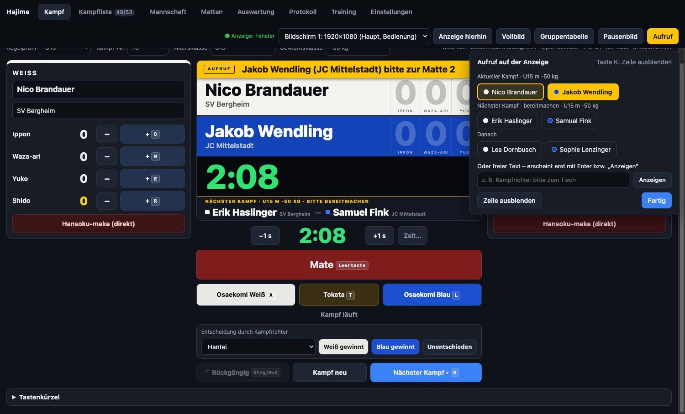 |

### Windows-App

Wie die macOS-App: Die Anzeige öffnet sich selbst im Vollbild auf dem zweiten Bildschirm, und der Rechner kann **Zentrale** für [Matten im Netz](#matten-im-netz) sein. Die portable `.exe` braucht keine Installation; Einstellungen und Protokoll liegen im Ordner `Hajime-Daten` neben der Datei (falls dort schreibbar). Beim ersten Start als Zentrale fragt die Windows-Firewall nach der Freigabe für das private Netzwerk – erlauben.

### Matten im Netz

Bei mehreren Matten können sich die Hajime-Rechner im selben (W)LAN verbinden. Dann laufen Ergebnisse ohne Excel-Umweg zurück, und die Turnierleitung sieht alle Matten auf einen Blick. Nur lokales Netz, kein Internet nötig.

1. **Zentrale** (z. B. der Rechner der Turnierleitung, macOS- oder Windows-App): *Einstellungen → Matten im Netz → Dieser Rechner: Zentrale*. Hajime zeigt einen **Turniercode** (4 Ziffern) und die Adresse.
2. **Mattenrechner:** Hajime findet die Zentrale von selbst und fragt *„Zentrale gefunden – diese Matte verbinden?“*. Turniercode und Mattenname eingeben, fertig. Klappt die Suche nicht, unter *Einstellungen → Matten im Netz* die Adresse von Hand eintragen (z. B. `192.168.1.20`).
3. In der Zentrale im Reiter *Matten* bei jeder Matte *Kampfliste senden* – oder wie bisher per *Excel je Matte*.

Danach meldet jede Matte laufend ihren Stand. Beendete Kämpfe landen automatisch in der Kampfliste der Zentrale (Protokoll, Gruppentabellen, Turnierbäume, Siegerliste). Von der Zentrale aus lässt sich ein **Aufruf** an die Anzeige einer bestimmten Matte schicken. **Übersicht im Browser** öffnet `http://<zentrale>:47801/` – das kann auch ein Fernseher oder Tablet in der Halle anzeigen.

- Der Turniercode verhindert, dass sich zwei Turniere in derselben Halle mischen.
- Bricht die Verbindung ab, läuft die Matte ganz normal weiter und reicht den Stand nach dem Wiederverbinden nach.
- **Hallen- und Gäste-WLANs** blockieren oft die Verbindung zwischen Geräten („Client Isolation“). Dann einen eigenen Router oder einen Handy-Hotspot verwenden.
- **macOS** fragt beim ersten Start nach *Lokales Netzwerk* bzw. eingehenden Verbindungen, **Windows** nach der Firewall-Freigabe – jeweils erlauben (bei der Zentrale *und* den Matten).
- Die **Webversion** kann keine Zentrale sein (der Browser erlaubt keinen Server und keine Netzwerksuche), sich aber als Matte mit einer Zentrale verbinden: Adresse von Hand eintragen. Das klappt nur, wenn die Webversion per Doppelklick oder über `http://` geöffnet ist, nicht über `https://`.
- Technik: Die Zentrale ruft sich alle 2 Sekunden per UDP-Broadcast und Multicast (Port 47800) ins Netz, die Matten verbinden sich per WebSocket (Port 47801).

### Mannschaftskampf

Für Liga und Mannschaftsturnier, ab Stufe *Standard*, Reiter **Mannschaft**:

- Bezeichnung, Altersklasse (wählt das Regelprofil), die beiden Mannschaften und die **Gewichtsklassen in Kampfreihenfolge** eintragen. *Beginn mit* legt die Klasse fest, mit der begonnen wird (z. B. ausgelost); danach geht es reihum.
- **Aufstellung** je Gewichtsklasse eintippen oder *Aufstellung aus Excel …* (Vorlage über *Excel-Vorlage speichern*). Ein leeres Feld heißt *nicht besetzt*: Die andere Mannschaft gewinnt den Kampf kampflos.
- Optional **Hin- und Rückrunde**; die Aufstellung der Hinrunde wird für die Rückrunde vorgeschlagen und lässt sich ändern.
- **Mannschaftskampf aktiv** setzt die Einzelkämpfe in die Kampfliste. *Nächster Kampf* geht sie der Reihe nach durch, die Anzeige zeigt unter der Kopfzeile den **Mannschaftsstand** (Siege und Wertungspunkte) und „Kampf 6 von 10“.
- **Wertung:** Unterbewertungen je Sieg (Standard: Ippon 10, Waza-ari 7, Yuko 5, Entscheidung 1, kampflos 10) und ob bei gleich vielen Siegen die Unterbewertungen entscheiden oder die Begegnung unentschieden endet.
- **Ergebnisbogen** der Begegnung als PDF zum Ausdrucken und Unterschreiben (Mannschaftsführer, Kampfrichter) oder als Excel.

### Trainingsmodus

Für das normale Training, in allen Stufen, Reiter **Training**:

- Rundenzeit, Pausenzeit und Rundenanzahl einstellen, dazu Hinweise für Runde und Pause (z. B. „Partnerwechsel“, „Start in Bodenlage“). Mitgeliefert sind die Vorlagen *Randori Kinder*, *Randori Erwachsene*, *Ne-waza* und *Uchi-komi Intervall*; eigene Einstellungen lassen sich als Vorlage speichern.
- *Start* (oder `Leertaste`) schaltet die Anzeige auf die große Trainingsuhr mit Rundenzähler. Farben: **grün** = Runde, **gelb** = letzte 10 Sekunden, **blau** = Pause.
- Gong bei Rundenbeginn und -ende, kurzer Signalton 10 Sekunden vor Rundenende. Bei *nur Signalton* (z. B. Uchi-komi) gibt es statt des Gongs einen kurzen Ton.
- *Zurück zur Wettkampfanzeige* schaltet wieder auf die normale Tafel.

### Sprachen

Unter *Einstellungen → Bedienung* lassen sich die **Sprache der Bedienung** und die **Sprache der Anzeige** getrennt wählen – z. B. Bedienung auf Deutsch, Anzeige auf Englisch bei einem internationalen Turnier. Beim ersten Start gilt die Sprache des Betriebssystems bzw. Browsers, sonst Englisch.

- Zurzeit: **Deutsch** und **Englisch**. Judo-Begriffe (Hajime, Mate, Osaekomi, Ippon, Waza-ari, Yuko, Shido …) bleiben japanisch.
- Ausdrucke (Aushang, Siegerliste, Urkunden, Ergebnisbogen) und Excel-Dateien entstehen in der Sprache der Bedienung. Der Excel-Import erkennt deutsche und englische Spaltenüberschriften („Verein“ / „Club“, „Gewichtsklasse“ / „Weight category“ …).
- **Weitere Sprache ergänzen:** `src/lang/en.js` kopieren (z. B. als `fr.js`), in der ersten Zeile Sprachkürzel und Namen ändern, die rechte Seite übersetzen und die Datei in `src/control.html` und `src/board.html` nach `lang/en.js` eintragen. Fehlende Einträge erscheinen auf Englisch; `node scripts/i18n-keys.js fr` listet sie auf. Übersetzungen gern als Pull Request.

### Ruhezeit

- Im Regelprofil steht eine **Mindestpause** zwischen zwei Kämpfen eines Kämpfers (Vorschlag: U11/U13 5 Minuten, ab U15 10 Minuten; 0 = keine Warnung).
- Wird ein Kampf geladen, dessen Kämpfer die Pause noch nicht hatte, zeigt Hajime die Restzeit („noch 2:40, bereit ab 09:49“) und schlägt Kämpfe vor, deren Kämpfer schon bereit sind – *Vorziehen* setzt diesen Kampf in der Kampfliste davor und lädt ihn. *Trotzdem laden* geht natürlich auch.
- In der Kampfliste steht bei jedem Kämpfer, der noch Pause hat, die verbleibende Zeit.

## Excel-Import

Im Reiter **Kampfliste** gibt es *Excel-Vorlage speichern*. Die Vorlage hat zwei Blätter – eines reicht:

- **Kampfliste** – fertige Paarungen: `Nr`, `Altersklasse`, `Geschlecht`, `Gewichtsklasse`, `Weiß Name`, `Weiß Verein`, `Blau Name`, `Blau Verein`
- **Teilnehmer** – nur Namen: `Vorname`, `Nachname` (oder `Name`), `Verein`, `Altersklasse`, `Geschlecht`, `Gewichtsklasse`.
  Daraus erzeugt die App pro Gruppe die Kampfliste im passenden Turniersystem.

`Geschlecht` ist optional und zählt nur mit der Einstellung *nach Geschlecht trennen*.

Die Spalten werden an den Überschriften erkannt, die Reihenfolge ist egal. CSV geht auch.

Zum Ausprobieren: [`beispiel/Beispiel-Teilnehmer-20.xlsx`](beispiel/Beispiel-Teilnehmer-20.xlsx) – 20 erfundene Kämpfer in 5 Gruppen (U11–U15), ergibt mit „Kampflisten aller Gruppen erzeugen“ 31 Kämpfe (alle „Jeder gegen jeden“). Mit Spalte „Geschlecht“ (12 m, 8 w): Ist „Nach Geschlecht trennen“ eingeschaltet, werden daraus 9 Gruppen.
Die **Altersklasse** wählt beim Laden eines Kampfes automatisch das passende Regelprofil (Name oder Alias, z. B. „U12, U13“).

## Regelprofile

Unter **Einstellungen → Regelprofile**. Mitgeliefert: U11, U13, U15, U18, Erwachsene, Masters.
Die Kampfzeiten sind Vorschläge – bitte mit der jeweiligen Ausschreibung abgleichen.
Für U11/U13 ist „Ippon beendet den Kampf“ ab Werk ausgeschaltet; es zählt dann die Anzahl der Wertungen nach Ablauf der Zeit.

## Entwicklung

```bash
npm install
npm start           # App starten
npm test            # Tests: Wettkampflogik, Turniersysteme, Matten, Excel, Training, Mannschaft, Netz, Sprachen
npm run build:web   # Webversion nach dist/Hajime-Web bauen
HAJIME_SCREENSHOTS=docs/screenshots npx electron .   # README-Screenshots neu erzeugen
```

Aufbau:

- `main.js` – Electron-Hauptprozess (Fenster, Bildschirme, Vollbild, Menü)
- `hub.js` – Zentrale für Matten im Netz: HTTP/WebSocket-Server und Suche per Broadcast/Multicast, reines Node.js
- `src/overview.html` – Übersicht aller Matten im Browser (liefert die Zentrale aus)
- `src/js/core.js` – Wettkampfregeln, ohne Oberfläche, mit Tests in `test/`
- `src/js/brackets.js` – Turniersysteme (Auslosung, Paarungen, Nachrücken, Platzierung), ohne Oberfläche
- `src/js/mats.js` – Verteilung auf Matten und Reihenfolge je Matte, ohne Oberfläche
- `src/js/net.js` – Stand einer Matte, Ergebnisse übernehmen, Kampfliste senden, WebSocket-Verbindung zur Zentrale
- `src/js/team.js` – Mannschaftskampf (Aufstellung, Mannschaftsstand, Ergebnisbogen), ohne Oberfläche
- `src/js/training.js` – Trainingsmodus (Runden, Pausen, Vorlagen), ohne Oberfläche
- `src/js/i18n.js` + `src/lang/*.js` – Mehrsprachigkeit; `scripts/i18n-keys.js` prüft Sprachdateien auf fehlende Texte
- `src/js/bracketview.js` – Turnierbaum als HTML (Bedienung, Anzeige, Druck)
- `src/js/render.js` + `src/css/board.css` – Anzeigetafel (auch als Vorschau im Bedienfenster)
- `src/js/control.js` – Bedienfenster
- `src/js/excel.js` – Import/Export (SheetJS liegt lokal in `src/vendor/`, funktioniert offline)
- `src/js/notice.js` – Aushang (Kampfreihenfolge pro Matte als Druckseite)
- `src/js/awards.js` – Siegerliste und Urkunden als Druckseiten
- `src/js/credits.js` + `src/css/credits.css` – Fenster *Über Hajime*
- `src/js/transport.js` – Verbindung der Fenster: Electron-IPC oder im Browser Pop-up + `postMessage`
- `scripts/build-web.js` – Webversion (Startseite, Web-App-Manifest, Offline-Speicher)

### Neue Version veröffentlichen

```bash
git tag v1.5.0
git push origin v1.5.0
```

GitHub Actions baut dann die Mac- und die Webversion, startet die App zur Probe und hängt beides an ein neues Release.

## Geplante Funktionen

Ideen und Wünsche stehen unter [Issues](https://github.com/junky84/hajime/issues), die Zuordnung zu den nächsten Versionen unter [Meilensteine](https://github.com/junky84/hajime/milestones).

## Code signing policy

Free code signing provided by [SignPath.io](https://about.signpath.io), certificate by [SignPath Foundation](https://signpath.org).

Die Windows-Programme (`Hajime.exe` und `Hajime-x.y.z-Windows-portable.exe`) werden in GitHub Actions direkt aus diesem Repository gebaut und anschließend über SignPath signiert; jede Signatur wird von Hand freigegeben. Signiert wird nur, was aus dem Quellcode dieses Repositorys gebaut wurde.

**Rollen**

- Committers and reviewers: [junky84](https://github.com/junky84)
- Approvers: [junky84](https://github.com/junky84)

Änderungen von anderen (Pull Requests) werden vor dem Übernehmen geprüft.

**Privacy policy**

This program will not transfer any information to other networked systems unless specifically requested by the user or the person installing or operating it.

Hajime braucht kein Internet und sendet keine Daten an Dritte. Netzwerkverbindungen gibt es nur, wenn sie ausdrücklich eingeschaltet werden: *Matten im Netz* verbindet Hajime-Rechner im selben lokalen Netz miteinander, der Link im Fenster *Über Hajime* öffnet GitHub im Browser.

## Hinweis

Diese App wurde mit Unterstützung von KI (Claude, Anthropic) entwickelt.

## Lizenz

MIT – siehe [LICENSE](LICENSE).

Die Schrift VT323 im Fenster *Über Hajime* steht unter der SIL Open Font License 1.1 – siehe [src/fonts/VT323-OFL.txt](src/fonts/VT323-OFL.txt).
