# Hajime

**Judo-Anzeigetafel** für Wettkämpfe – **ohne Installation**: als **Webversion** für jeden Rechner mit Chrome oder Edge (läuft offline, keine Programmdatei) und als **App für macOS**.

- **Publikumsanzeige** im Vollbild auf dem zweiten Bildschirm/Beamer (erweiterter Desktop)
- **Bedienfenster** auf dem Laptop mit Live-Vorschau der Anzeige
- Namen optional, manuell oder per **Excel-Import**
- **Regelprofile** pro Altersklasse (Kampfzeit, Golden Score, „Ippon beendet den Kampf“ ja/nein, Yuko, Shido-Grenze, Osaekomi-Zeiten …)
- **Nächster Kampf** gut lesbar unten auf der Anzeige, in drei Größen
- **Ereignisprotokoll** jedes Kampfes und Ergebnis-Export nach Excel
- **Aushang** der Kampfreihenfolge pro Matte zum Ausdrucken (A4/A3)
- **Gruppentabellen** für „Jeder gegen jeden“ mit automatischer Platzierung, auch groß auf der Anzeige
- **Siegerliste und Urkunden** als PDF (Siegerliste auch als Excel)
- **Ruhezeit-Warnung**, wenn ein Kämpfer seine Mindestpause noch nicht hatte

## Screenshots

**Publikumsanzeige** (Vollbild auf Beamer/zweitem Bildschirm)

| Kampf läuft mit Osaekomi | Kampfende mit Sieger |
|---|---|
| 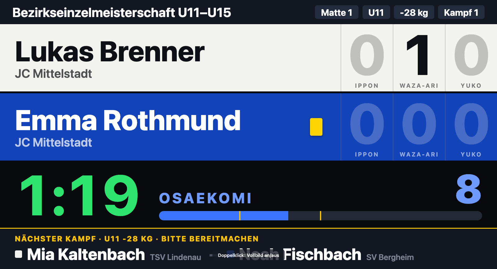 | 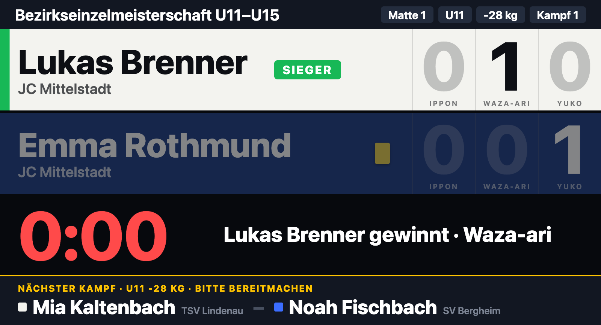 |
| **Golden Score** | **Pausenbild mit den nächsten Kämpfen** |
| 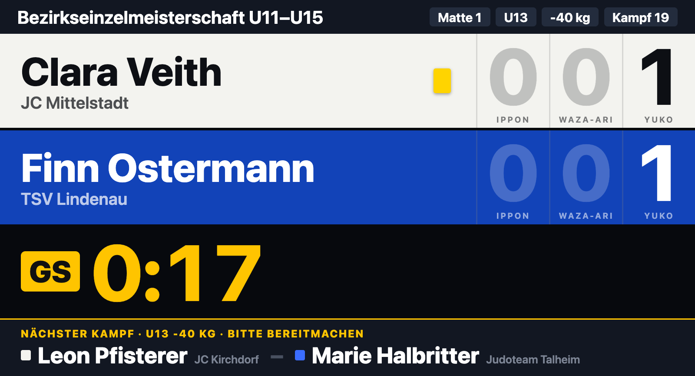 | 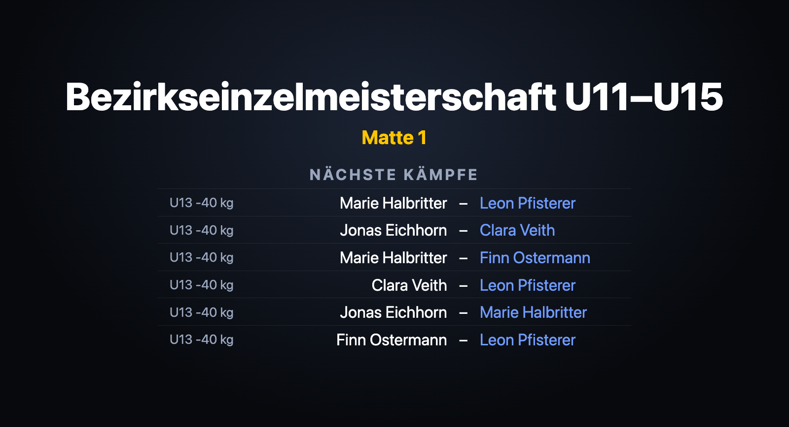 |
| **Gruppentabelle** (Taste `G`) | |
| 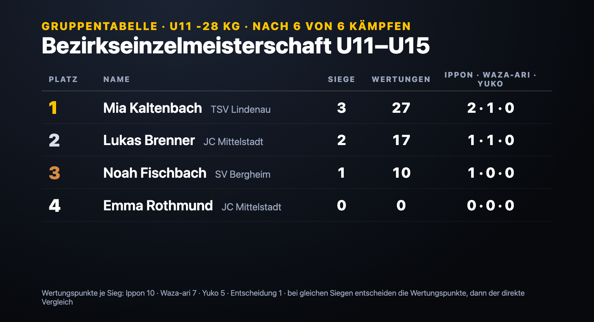 | |

**Bedienfenster** (Laptop)

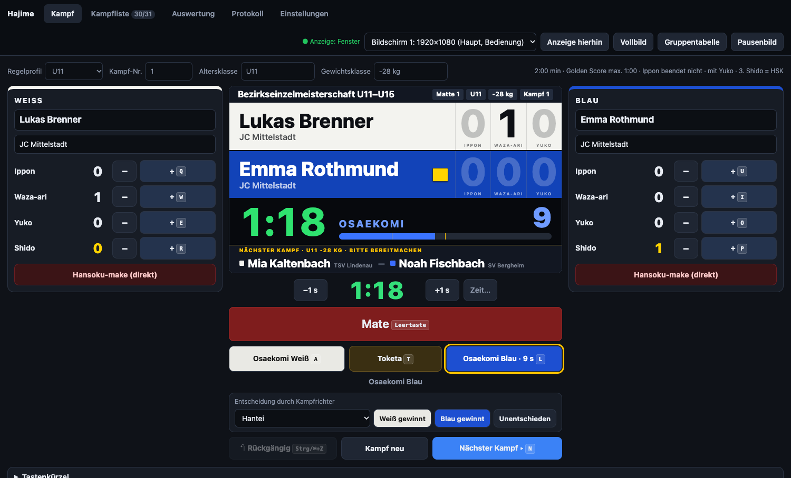

| Kampfliste & Teilnehmer (Excel-Import, Jeder gegen jeden) | Einstellungen & Regelprofile |
|---|---|
| 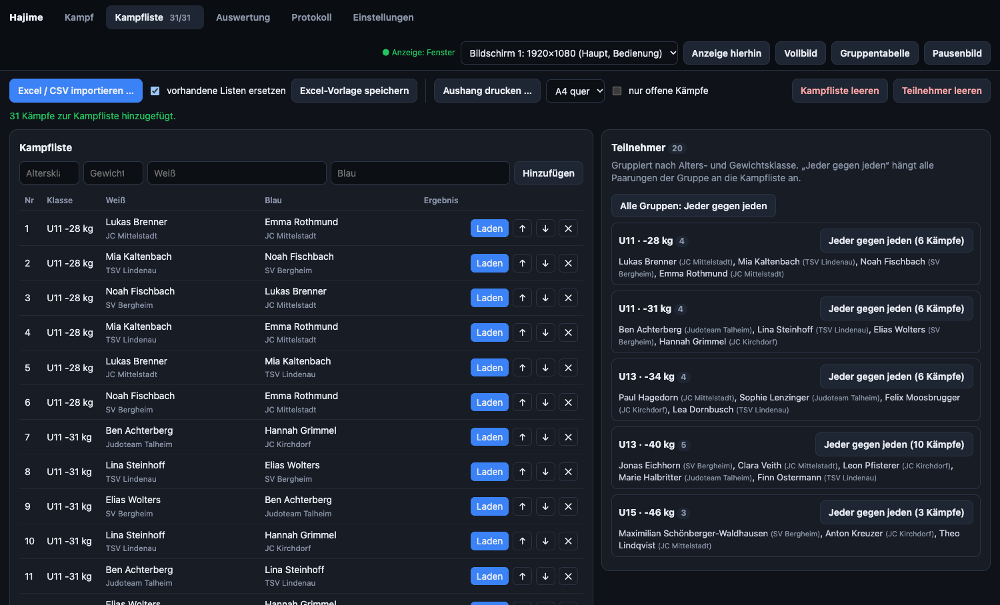 | 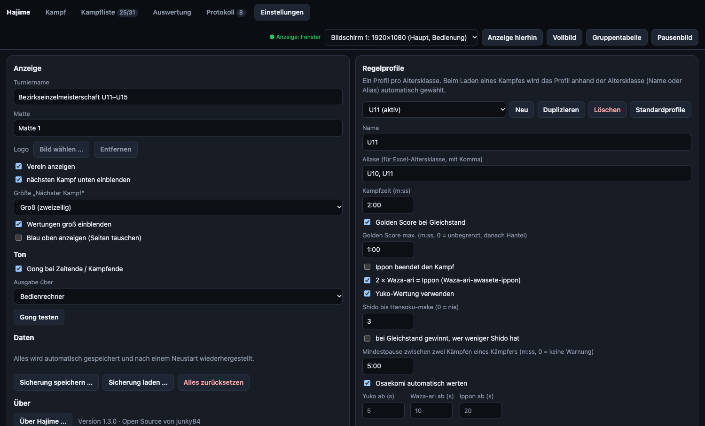 |
| **Auswertung** (Gruppentabellen, Siegerliste, Urkunden) | **Ruhezeit-Warnung** beim Laden eines Kampfes |
| 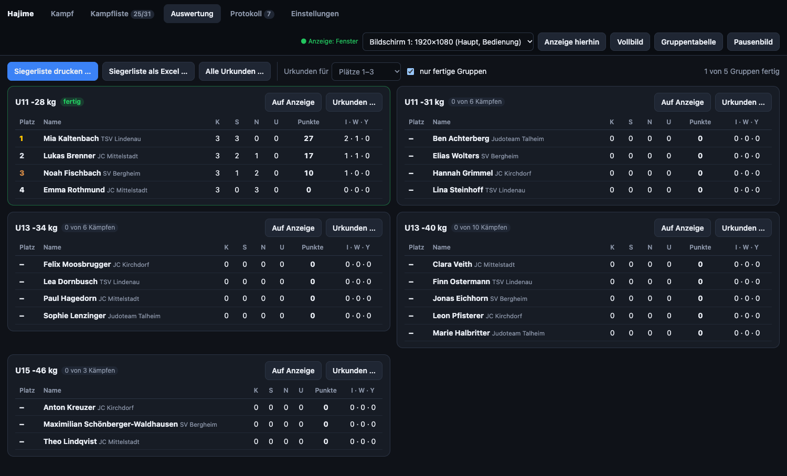 | 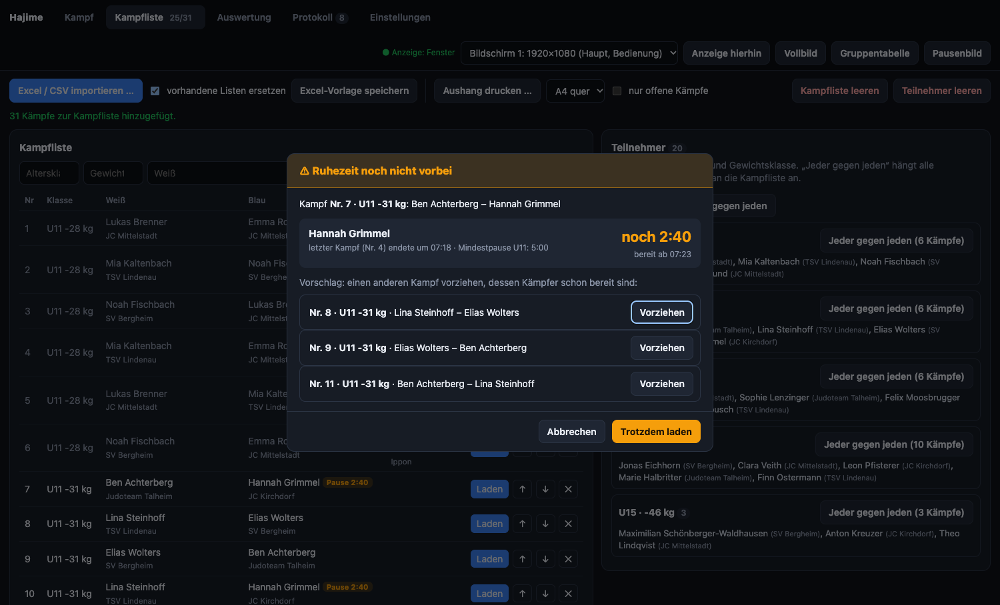 |

**Ausdrucke** (PDF)

| Urkunde | Siegerliste |
|---|---|
| 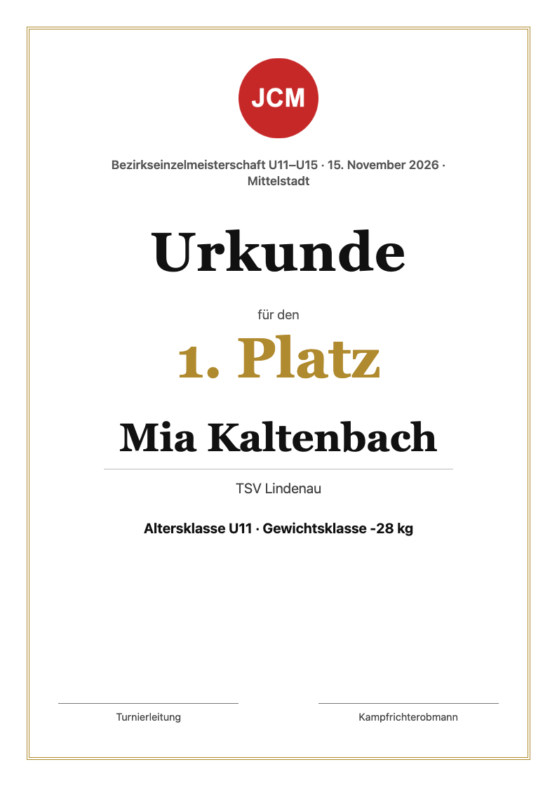 | 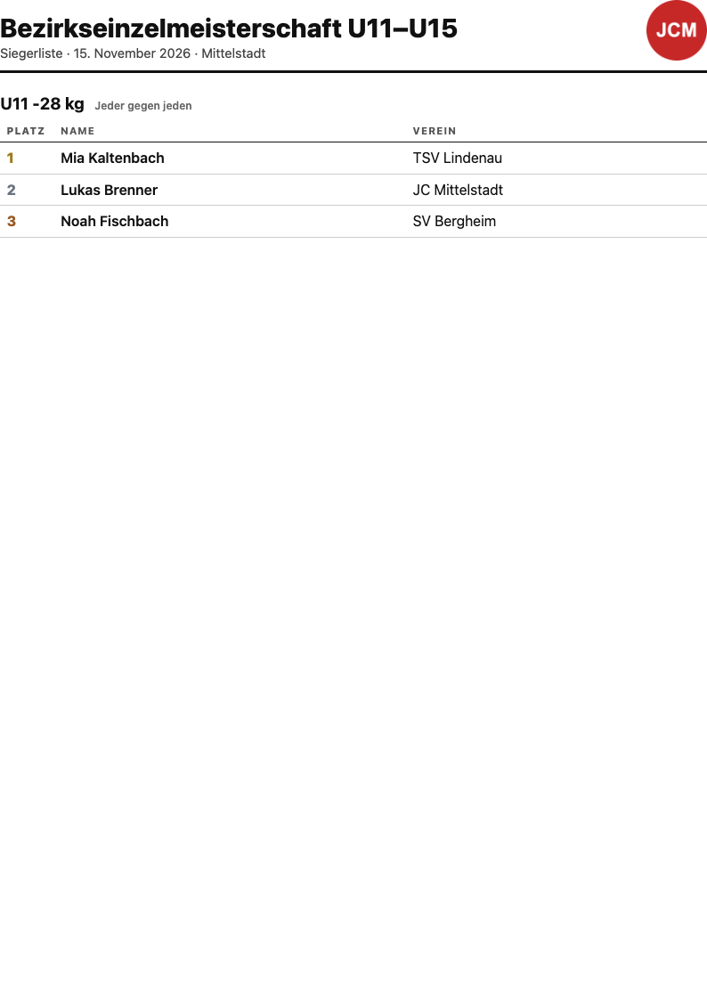 |

Alle Namen in den Screenshots sind erfunden (aus der [Beispiel-Excel](beispiel/Beispiel-Teilnehmer-20.xlsx)).

## Download & Start

Die fertigen Dateien liegen unter **Releases**.

| Version | Datei | Start |
|---|---|---|
| **Webversion** – jeder Rechner mit Chrome oder Edge | `Hajime-x.y.z-Web.zip` | Entpacken, `Hajime starten.html` öffnen. |
| **macOS-App** (Apple Silicon + Intel) | `Hajime-x.y.z-Mac.zip` | Entpacken, `Hajime.app` starten. |

### Webversion

Dieselbe Anzeigetafel, nur im Browser: keine Installation, keine Programmdatei, **kein Internet nötig**. Ideal für Vereins- oder Leihrechner, auf denen keine fremden Programme laufen dürfen.

1. `Hajime-x.y.z-Web.zip` entpacken und `Hajime starten.html` in **Chrome oder Edge** öffnen.
2. *Anzeige öffnen* klicken und Pop-ups erlauben, falls der Browser fragt.
3. Beim ersten Mal fragt der Browser, ob die Seite **Fenster auf allen Bildschirmen verwalten** darf. Mit *Zulassen* erscheint oben eine Bildschirmauswahl und die Anzeige landet automatisch auf dem Beamer. Ohne Erlaubnis das Fenster von Hand hinüberziehen.
4. Im Anzeigefenster **einmal klicken** (Browser geben den Ton erst nach einem Klick frei – bis dahin steht dort ein roter Hinweis) und **doppelklicken** für Vollbild.

Einstellungen, Kampfliste und Protokoll speichert der Browser. Für einen anderen Rechner unter *Einstellungen* eine Sicherung speichern und dort laden.

**Als Web-App:** Der Ordner kann auch auf einen Webserver gelegt werden. Dann lässt sich Hajime in Chrome/Edge über das Installieren-Symbol in der Adressleiste wie eine App anlegen und läuft nach dem ersten Aufruf offline.

Getestet ist die Webversion mit Chrome/Edge. Firefox und Safari sollten grundsätzlich laufen, können die Anzeige aber nicht selbst auf den zweiten Bildschirm schieben.

### macOS-App

Die App öffnet die Anzeige selbst im Vollbild auf dem zweiten Bildschirm und braucht keinen Klick für den Ton.

**Erster Start** (die App ist nicht kostenpflichtig signiert): Meldung „kann nicht geöffnet werden“ → *Systemeinstellungen → Datenschutz & Sicherheit* → ganz unten *Dennoch öffnen*.
Alternativ im Terminal: `xattr -cr /Pfad/zu/Hajime.app`

## Bedienung

1. Hajime starten. In der **macOS-App** öffnet sich die Anzeige automatisch im Vollbild auf dem zweiten Bildschirm (ist keiner angeschlossen: als Fenster). In der **Webversion** *Anzeige öffnen* klicken (siehe oben). Oben rechts kann der Bildschirm gewechselt werden.
2. Namen eintragen (optional) oder Kampfliste laden, *Hajime* drücken.
3. Nach dem Kampf *Nächster Kampf* (Taste `N`) – das Ergebnis landet automatisch im Protokoll.

### Tastenkürzel

| Taste | Aktion |
|---|---|
| `Leertaste` | Hajime / Mate (nach Zeitende bei Gleichstand: Golden Score starten) |
| `A` / `L` | Osaekomi Weiß / Blau (nochmal drücken = Toketa) |
| `T` | Toketa |
| `Q` `W` `E` `R` | Weiß: Ippon, Waza-ari, Yuko, Shido |
| `U` `I` `O` `P` | Blau: Ippon, Waza-ari, Yuko, Shido |
| `Shift` + Wertungstaste | Wertung abziehen |
| `↑` / `↓` | Uhr ±1 Sekunde |
| `Strg/⌘ + Z` | Rückgängig |
| `N` | Nächster Kampf |
| `B` | Pausenbild (Turniername, Logo, nächste Kämpfe) an/aus |
| `G` | Gruppentabelle der aktuellen Klasse an/aus |

Im Anzeigefenster: Doppelklick oder `F` = Vollbild an/aus.

### Was die Tafel automatisch macht

- Kampfzeit, Golden Score (optional mit Höchstdauer → danach Kampfrichterentscheid)
- Osaekomi-Uhr mit automatischer Wertung (Standard: 5 s Yuko, 10 s Waza-ari, 20 s Ippon), läuft nach Zeitende weiter
- 2× Waza-ari = Ippon, 3. Shido = Hansoku-make (abschaltbar)
- Sieger nach Zeitende über die Wertungen; große Einblendung der Wertung auf der Anzeige
- Gong bei Zeit- und Kampfende (wahlweise am Bedienrechner oder über die Anzeige)
- Manuelle Entscheidungen: Hantei, Kiken-gachi, Fusen-gachi, Disqualifikation, Unentschieden
- Alles wird laufend gespeichert und nach einem Absturz/Neustart wiederhergestellt

### Auf der Anzeige und im Protokoll

- **Nächster Kampf** unten auf der Anzeige, damit sich die Kämpfer bereitmachen: in drei Größen (*Einstellungen → Anzeige*): klein in einer Zeile, groß zweizeilig (Standard) oder sehr groß mit jedem Kämpfer in einer eigenen Zeile. Lange Namen werden verkleinert, nie abgeschnitten.
- **Ereignisprotokoll pro Kampf:** Jede Aktion wird mit Uhrzeit und Kampfzeit gespeichert – Hajime/Mate, Wertungen, Shido, Osaekomi und Toketa, Korrekturen, Rückgängig, Entscheidung. Im Reiter *Protokoll* pro Kampf über *Ereignisse* aufklappen; der Excel-Export enthält dafür ein eigenes Blatt „Ereignisse“.
- **Aushang:** Im Reiter *Kampfliste* erzeugt *Aushang drucken …* die Kampfreihenfolge pro Matte zum Aushängen (A4 oder A3 quer, auf Wunsch nur offene Kämpfe) – bewusst ohne Uhrzeiten und ohne Ergebnisse. Die macOS-App speichert direkt ein PDF, die Webversion öffnet den Druckdialog (dort *Als PDF sichern* wählen).
- **Über Hajime:** im Menü, unter *Einstellungen* oder mit einem Dreifachklick auf „Hajime“ oben links.

### Auswertung und Siegerehrung

- **Gruppentabellen:** Der Reiter *Auswertung* rechnet für jede Alters-/Gewichtsklasse der Kampfliste („Jeder gegen jeden“) die Platzierung selbst aus: Siege, Wertungspunkte und wie gewonnen wurde (Ippon · Waza-ari · Yuko). Wertungspunkte je Sieg: Ippon 10, Waza-ari 7, Yuko 5, Entscheidung (Hantei, Shido) 1 – änderbar unter *Einstellungen → Auswertung*. Bei gleich vielen Siegen entscheiden die Wertungspunkte und dann der direkte Vergleich (oder umgekehrt, je nach Ausschreibung).
- **Stichkampf:** Bleibt ein Gleichstand (z. B. drei Kämpfer im Kreis), markiert Hajime „Stichkampf nötig“. *Stichkampf anlegen* setzt die nötigen Kämpfe als nächste in die Kampfliste; sie entscheiden nur den Gleichstand und zählen nicht als Siege.
- **Auf der Anzeige:** *Gruppentabelle* oben rechts (Taste `G`) zeigt die Tabelle der aktuellen Klasse groß für Kämpfer und Eltern, *Auf Anzeige* in der Auswertung eine bestimmte Gruppe.
- **Siegerliste** (Plätze 1–3 je Gruppe) als PDF oder Excel; der Protokoll-Export enthält zusätzlich ein Blatt „Gruppentabellen“.
- **Urkunden** als PDF, eine A4-Seite pro Platzierung – pro Gruppe, sobald sie fertig ist, oder alle auf einmal. Mit Turniername, Datum, Ort, Name, Verein, Klasse und Platz, Vereinslogo aus *Anzeige* und zwei Unterschriftsfeldern; ein eigenes Hintergrundbild ersetzt den goldenen Rahmen. Wahlweise für Plätze 1–3 oder alle Platzierten.

### Ruhezeit

- Im Regelprofil steht eine **Mindestpause** zwischen zwei Kämpfen eines Kämpfers (Vorschlag: U11/U13 5 Minuten, ab U15 10 Minuten; 0 = keine Warnung).
- Wird ein Kampf geladen, dessen Kämpfer die Pause noch nicht hatte, zeigt Hajime die Restzeit („noch 2:40, bereit ab 09:49“) und schlägt Kämpfe vor, deren Kämpfer schon bereit sind – *Vorziehen* setzt diesen Kampf in der Kampfliste davor und lädt ihn. *Trotzdem laden* geht natürlich auch.
- In der Kampfliste steht bei jedem Kämpfer, der noch Pause hat, die verbleibende Zeit.

## Excel-Import

Im Reiter **Kampfliste** gibt es *Excel-Vorlage speichern*. Die Vorlage hat zwei Blätter – eines reicht:

- **Kampfliste** – fertige Paarungen: `Nr`, `Altersklasse`, `Gewichtsklasse`, `Weiß Name`, `Weiß Verein`, `Blau Name`, `Blau Verein`
- **Teilnehmer** – nur Namen: `Vorname`, `Nachname` (oder `Name`), `Verein`, `Altersklasse`, `Gewichtsklasse`.
  Daraus erzeugt die App pro Gruppe „Jeder gegen jeden“.

Die Spalten werden an den Überschriften erkannt, die Reihenfolge ist egal. CSV geht auch.

Zum Ausprobieren: [`beispiel/Beispiel-Teilnehmer-20.xlsx`](beispiel/Beispiel-Teilnehmer-20.xlsx) – 20 erfundene Kämpfer in 5 Gruppen (U11–U15), ergibt mit „Alle Gruppen: Jeder gegen jeden“ 31 Kämpfe.
Die **Altersklasse** wählt beim Laden eines Kampfes automatisch das passende Regelprofil (Name oder Alias, z. B. „U12, U13“).

## Regelprofile

Unter **Einstellungen → Regelprofile**. Mitgeliefert: U11, U13, U15, U18, Erwachsene, Masters.
Die Kampfzeiten sind Vorschläge – bitte mit der jeweiligen Ausschreibung abgleichen.
Für U11/U13 ist „Ippon beendet den Kampf“ ab Werk ausgeschaltet; es zählt dann die Anzahl der Wertungen nach Ablauf der Zeit.

## Entwicklung

```bash
npm install
npm start           # App starten
npm test            # Tests der Wettkampflogik und des Excel-Imports
npm run build:web   # Webversion nach dist/Hajime-Web bauen
HAJIME_SCREENSHOTS=docs/screenshots npx electron .   # README-Screenshots neu erzeugen
```

Aufbau:

- `main.js` – Electron-Hauptprozess (Fenster, Bildschirme, Vollbild)
- `src/js/core.js` – Wettkampfregeln, ohne Oberfläche, mit Tests in `test/`
- `src/js/render.js` + `src/css/board.css` – Anzeigetafel (auch als Vorschau im Bedienfenster)
- `src/js/control.js` – Bedienfenster
- `src/js/excel.js` – Import/Export (SheetJS liegt lokal in `src/vendor/`, funktioniert offline)
- `src/js/notice.js` – Aushang (Kampfreihenfolge pro Matte als Druckseite)
- `src/js/awards.js` – Siegerliste und Urkunden als Druckseiten
- `src/js/credits.js` + `src/css/credits.css` – Fenster *Über Hajime*
- `src/js/transport.js` – Verbindung der Fenster: Electron-IPC oder im Browser Pop-up + `postMessage`
- `scripts/build-web.js` – Webversion (Startseite, Web-App-Manifest, Offline-Speicher)

### Neue Version veröffentlichen

```bash
git tag v1.3.0
git push origin v1.3.0
```

GitHub Actions baut dann die Mac- und die Webversion, startet die App zur Probe und hängt beides an ein neues Release.

## Geplante Funktionen

Ideen und Wünsche stehen unter [Issues](https://github.com/junky84/hajime/issues), die Zuordnung zu den nächsten Versionen unter [Meilensteine](https://github.com/junky84/hajime/milestones).

## Hinweis

Diese App wurde mit Unterstützung von KI (Claude, Anthropic) entwickelt.

## Lizenz

MIT – siehe [LICENSE](LICENSE).

Die Schrift VT323 im Fenster *Über Hajime* steht unter der SIL Open Font License 1.1 – siehe [src/fonts/VT323-OFL.txt](src/fonts/VT323-OFL.txt).
