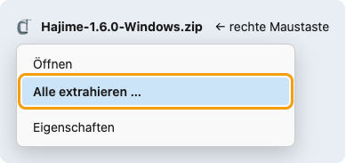
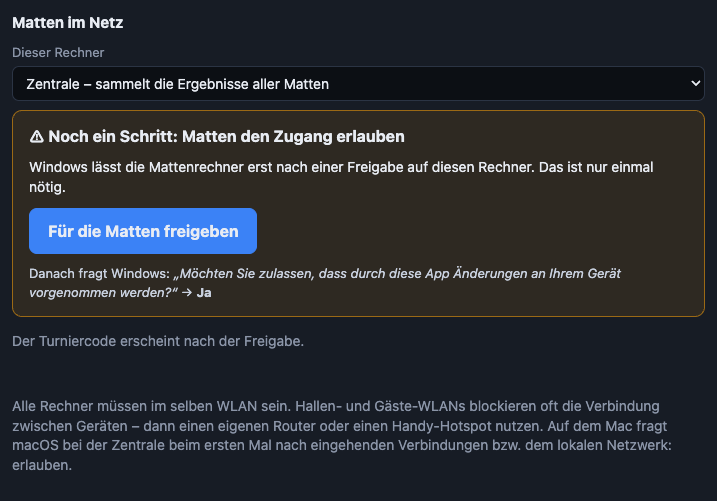
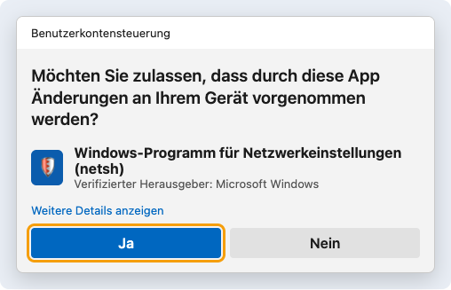
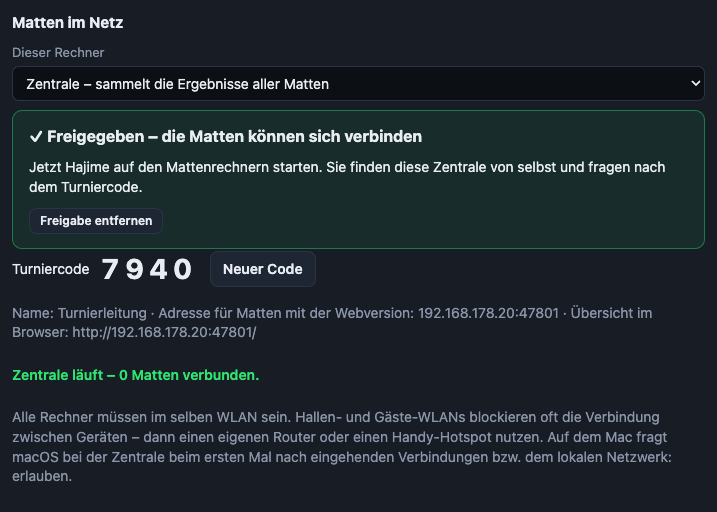
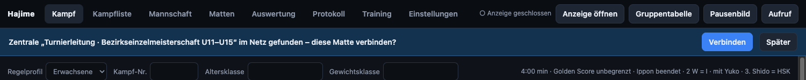
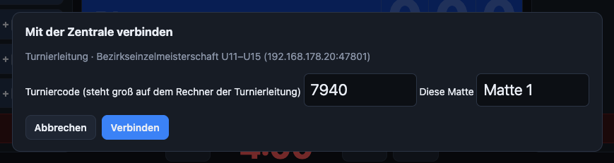
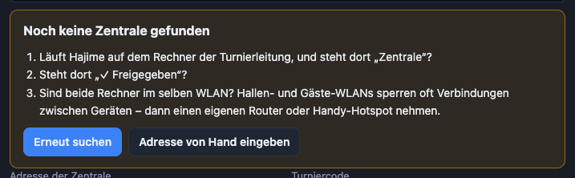

# Hajime – Benutzerhandbuch

Dieses Handbuch erklärt Hajime Schritt für Schritt – vom Herunterladen bis zum Turnier mit mehreren Matten. Du brauchst dafür keine Computerkenntnisse. Wer es eilig hat, fängt mit dem [Schnellstart](schnellstart.md) an.

> **Du musst nicht alles lesen.** Für eine Anzeigetafel im Training reichen die Kapitel 1 bis 5. Alles danach sind Zusatzfunktionen für Namen, Listen und Turniere.

**Inhalt**

1. [Was ist Hajime?](#was-ist-hajime)
2. [Was du brauchst](#was-du-brauchst)
3. [Herunterladen und starten](#herunterladen-und-starten)
4. [Erster Start: Wie viel Hajime brauchst du?](#erster-start-wie-viel-hajime-brauchst-du)
5. [Die Anzeige auf den Beamer bringen](#die-anzeige-auf-den-beamer-bringen)
6. [Einen Kampf führen](#einen-kampf-führen)
7. [Regelprofile: Kampfzeit und Regeln je Altersklasse](#regelprofile-kampfzeit-und-regeln-je-altersklasse)
8. [Namen und Kampfliste](#namen-und-kampfliste)
9. [Mannschaftskampf](#mannschaftskampf)
10. [Training](#training)
11. [Turnier: Systeme, Matten, Aufruf, Ruhezeit](#turnier-systeme-matten-aufruf-ruhezeit)
12. [Auswertung und Siegerehrung](#auswertung-und-siegerehrung)
13. [Mehrere Matten im Netz verbinden](#mehrere-matten-im-netz-verbinden)
14. [Sprachen](#sprachen)
15. [Daten sichern und auf einen anderen Rechner bringen](#daten-sichern-und-auf-einen-anderen-rechner-bringen)
16. [Wenn etwas nicht klappt](#wenn-etwas-nicht-klappt)
17. [Begriffe kurz erklärt](#begriffe-kurz-erklärt)

---

## Was ist Hajime?

Hajime ist eine **Anzeigetafel für Judo**. Sie läuft auf einem normalen Laptop und zeigt Kampfzeit, Wertungen, Shido und Osaekomi groß auf einem Beamer oder Fernseher.

Hajime hat immer **zwei Fenster**:

| Fenster | Wo | Wofür |
|---|---|---|
| **Bedienfenster** | auf dem Laptop | Hier klickst du bzw. drückst die Tasten: Hajime, Mate, Wertungen … Oben siehst du eine kleine Vorschau der Anzeige. |
| **Anzeige** | auf dem Beamer oder zweiten Bildschirm | Das sehen Kämpfer, Kampfrichter und Zuschauer – groß und ohne Knöpfe. |

Hajime braucht **kein Internet**, **keine Anmeldung** und **keine Installation**. Es kostet nichts (Open Source).

## Was du brauchst

- **Einen Laptop** mit Windows 10/11 oder macOS. Für die Webversion reicht jeder Rechner mit Chrome oder Edge.
- **Einen Beamer, Fernseher oder zweiten Bildschirm**, per Kabel (HDMI) am Laptop angeschlossen. Ohne zweiten Bildschirm geht es auch – dann erscheint die Anzeige als Fenster auf dem Laptop.
- Der zweite Bildschirm muss als **„Erweitern“** eingestellt sein, nicht als „Duplizieren“. Dann kann Hajime auf dem Laptop die Bedienung und auf dem Beamer die Anzeige zeigen.
  - **Windows:** Tasten `Windows` + `P` drücken → **Erweitern** wählen.
  - **Mac:** *Systemeinstellungen → Displays* → beim zweiten Bildschirm **Erweitern** (nicht „Synchronisieren“/„Spiegeln“).
- Für **Turniere mit mehreren Matten** zusätzlich ein WLAN für alle Laptops (Kapitel [13](#mehrere-matten-im-netz-verbinden)).

## Herunterladen und starten

Alle Dateien gibt es kostenlos unter **[Releases](https://github.com/junky84/hajime/releases/latest)** (unten bei „Assets“). Lade die Datei für deinen Rechner herunter:

| Dein Rechner | Datei | Das ist drin |
|---|---|---|
| **Windows-Laptop** (empfohlen) | `Hajime-x.y.z-Windows.zip` | Hajime für Windows: eigenes Fenster, kann auch Zentrale für mehrere Matten sein |
| **Mac** | `Hajime-x.y.z-Mac.zip` | Mac-App |
| **Irgendein Rechner mit Chrome oder Edge** (z. B. ein Leih-Laptop, auf dem du nichts starten darfst) | `Hajime-x.y.z-Web.zip` | Webversion im Browser |

`x.y.z` steht für die Versionsnummer, z. B. `1.6.0`.

### Windows

**Einmalig, am besten schon zu Hause:**

1. Die ZIP-Datei herunterladen (sie landet meist im Ordner *Downloads*).
2. **Rechte Maustaste** auf die ZIP-Datei → **Eigenschaften**. Unten bei *Sicherheit* das Häkchen **Zulassen** setzen → **OK**.
   Damit fragt Windows später beim Start nicht nach. Steht dort kein *Zulassen*, ist die Datei schon freigegeben.

   

3. **Rechte Maustaste** auf die ZIP-Datei → **Alle extrahieren …** → **Extrahieren**. Es entsteht ein Ordner `Hajime-x.y.z-Windows`.

   

**Starten – jedes Mal:**

4. Im entpackten Ordner doppelt auf **Hajime starten** klicken.

   

5. Ein schwarzes Fenster blitzt kurz auf und schließt sich wieder. Danach öffnet sich Hajime in einem **eigenen Fenster** (das ist Microsoft Edge, nur ohne Adressleiste).
6. **Beenden:** das Hajime-Fenster schließen. Deine Daten bleiben gespeichert.

Gut zu wissen:

- Den Ordner `programm` musst du nicht öffnen. Darin liegt Node.js (`node.exe`, eine von der OpenJS Foundation signierte Laufzeitumgebung) und die Hajime-Dateien. Hajime installiert nichts und verändert nichts außerhalb des Ordners – außer der [Freigabe für die Zentrale](#zentrale-einschalten), wenn du sie nutzt.
- Läuft Hajime schon und du klickst noch einmal auf *Hajime starten*, öffnet sich kein zweites Hajime. Schau dann in der Taskleiste nach dem Hajime-Fenster.
- Bitte **nicht aus der ZIP-Datei heraus** starten (Doppelklick in die ZIP, ohne zu entpacken). Dann fehlt der Ordner `programm` und Hajime meldet: „Bitte die ZIP-Datei zuerst entpacken“.
- Eine **neue Version**: wieder herunterladen und entpacken. Deine Daten (Einstellungen, Kampflisten, Protokoll) bleiben erhalten, weil sie in Edge auf diesem Rechner gespeichert sind. Den alten Ordner kannst du löschen.

### Mac

1. Die ZIP-Datei herunterladen und doppelklicken – es entsteht `Hajime.app`. Am besten in den Ordner *Programme* ziehen.
2. `Hajime.app` doppelklicken.
3. **Beim allerersten Start** meldet macOS: *„Hajime“ kann nicht geöffnet werden*. Das liegt daran, dass Hajime nicht kostenpflichtig bei Apple registriert ist.
   → *Systemeinstellungen → Datenschutz & Sicherheit* → ganz nach unten scrollen → **Dennoch öffnen** → mit deinem Mac-Passwort bestätigen. Danach startet Hajime ganz normal.

### Webversion (jeder Rechner mit Chrome oder Edge)

1. Die ZIP-Datei herunterladen und entpacken (Windows: rechte Maustaste → *Alle extrahieren*).
2. Im Ordner **Hajime starten.html** mit Chrome oder Edge öffnen (Doppelklick oder ins Browserfenster ziehen).

Die Webversion kann fast alles. Sie kann aber **nicht Zentrale** für mehrere Matten sein und findet eine Zentrale auch nicht von selbst (siehe Kapitel [13](#mehrere-matten-im-netz-verbinden)). Sie speichert ihre Daten im Browser.

## Erster Start: Wie viel Hajime brauchst du?

Beim ersten Start fragt Hajime: **„Wie möchtest du Hajime nutzen?“**

| Umfang | Du bekommst … | Gut für |
|---|---|---|
| **Einfach** | nur die Anzeigetafel: Uhr, Hajime/Mate, Osaekomi, Wertungen, Shido, Rückgängig, Regelprofil, Trainingsuhr. Keine Namen, keine Listen. | Training, Randori, kleine Vereinsmeisterschaft ohne Namen |
| **Standard** | dazu Namen und Vereine, Kampfliste mit Excel-Import, Aushang, Protokoll, Pausenbild, Mannschaftskampf | Vereinsmeisterschaft, Liga, Freundschaftskampf |
| **Turnier** | alles: Turniersysteme, mehrere Matten, Matten im Netz, Auswertung, Siegerliste, Urkunden, Aufruf | Turniere |

Du kannst das jederzeit ändern: *Einstellungen → Bedienung → Umfang*. Dabei geht nichts verloren – Ausgeblendetes wird nur versteckt.

So sieht **Einfach** aus:

| Bedienfenster | Anzeige |
|---|---|
|  |  |

## Die Anzeige auf den Beamer bringen

**Mac-App:** Die Anzeige öffnet sich von selbst im Vollbild auf dem zweiten Bildschirm. Oben rechts im Bedienfenster kannst du den Bildschirm wechseln.

**Hajime für Windows und Webversion:**

1. Oben rechts auf **Anzeige öffnen** klicken.
2. Beim ersten Mal fragt Edge bzw. Chrome, ob Hajime **Fenster auf allen Bildschirmen verwalten** darf → **Zulassen**. Dann erscheint oben eine Bildschirmauswahl, und die Anzeige landet von selbst auf dem Beamer.
   Ohne diese Erlaubnis öffnet sich die Anzeige als normales Fenster – dann ziehst du es mit der Maus auf den Beamer.
3. Fragt der Browser nach **Pop-ups**: erlauben.
4. **In das Anzeigefenster einmal klicken.** Browser geben den Ton (Gong) erst nach einem Klick frei. Bis dahin steht dort ein roter Hinweis.
5. **Doppelklick** in die Anzeige (oder Taste `F`) = Vollbild an/aus.

Unter *Einstellungen → Ton* stellst du ein, ob der Gong aus dem Laptop, aus dem Beamer (Anzeige-Fenster) oder aus beiden kommt. *Gong testen* spielt ihn einmal ab.

## Einen Kampf führen

Das Wichtigste vorweg: **Leertaste = Hajime / Mate.** Alles andere geht mit der Maus oder mit Tasten.

### Ablauf

1. Oben das **Regelprofil** wählen (z. B. *U13*). Es bestimmt Kampfzeit, Golden Score und Osaekomi-Zeiten.
2. Optional Namen eintragen – oder einfach ohne Namen kämpfen.
3. **Leertaste** (oder Knopf *Hajime*): Die Uhr läuft. Nochmal Leertaste: *Mate*, die Uhr steht.
4. **Wertungen und Shido** über die Knöpfe bei *WEISS* bzw. *BLAU* oder per Taste geben (Tabelle unten).
5. **Osaekomi:** Knopf *Osaekomi Weiß* bzw. *Osaekomi Blau* (Tasten `A` / `L`). Die Osaekomi-Uhr läuft und gibt automatisch Yuko, Waza-ari oder Ippon. **Toketa:** dieselbe Taste noch einmal oder `T`.
6. Am Ende entscheidet Hajime von selbst: Ippon, Zeitende mit Wertungsvorsprung, 3. Shido … Die Anzeige blendet den Sieger groß ein.
7. **Gleichstand nach Zeitende:** Leertaste startet den **Golden Score**.
8. **Nächster Kampf ▸** (Taste `N`) – das Ergebnis landet automatisch im Protokoll. Oder **Kampf neu**, um denselben Kampf frisch zu beginnen.

### Vertan? Kein Problem

- **↶ Rückgängig** (`Strg` + `Z`, am Mac `⌘` + `Z`) nimmt den letzten Schritt zurück – auch mehrmals.
- **Wertung abziehen:** `Shift` + Wertungstaste.
- **Uhr korrigieren:** `↑` / `↓` = ±1 Sekunde, oder auf *Zeit…* klicken und die Zeit eintippen.

### Entscheidung durch die Kampfrichter

Ergebnisse, die nicht von der Uhr kommen, gibst du unten unter **Entscheidung durch Kampfrichter** ein: in der Liste die Art wählen – *Hantei*, *Kiken-gachi (Aufgabe)*, *Fusen-gachi (nicht angetreten)*, *Hansoku-make*, *Disqualifikation* oder *Verletzung* – und dann auf **Weiß gewinnt** oder **Blau gewinnt** klicken. Außerdem gibt es **Unentschieden**; eine eingetragene Entscheidung lässt sich mit *Aufheben* wieder entfernen.

### Tastenkürzel

| Taste | Aktion |
|---|---|
| `Leertaste` | Hajime / Mate (nach Zeitende bei Gleichstand: Golden Score starten) |
| `A` / `L` | Osaekomi Weiß / Blau (nochmal drücken = Toketa) |
| `T` | Toketa |
| `Q` `W` `E` `R` | Weiß: Ippon, Waza-ari, Yuko, Shido |
| `U` `I` `O` `P` | Blau: Ippon, Waza-ari, Yuko, Shido |
| `Shift` + Wertungstaste | Wertung abziehen |
| `↑` / `↓` | Uhr ±1 Sekunde |
| `Strg/⌘` + `Z` | Rückgängig |
| `N` | Nächster Kampf |
| `B` | Pausenbild an/aus |
| `G` | Gruppentabelle bzw. Turnierbaum an/aus |
| `K` | Kämpfer aufrufen |

Im Anzeigefenster: Doppelklick oder `F` = Vollbild. Die Tasten stehen auch unten im Bedienfenster unter *Tastenkürzel*.

### Was Hajime von selbst macht

- Kampfzeit und Golden Score (auf Wunsch mit Höchstdauer, danach Hantei)
- Osaekomi-Uhr mit automatischer Wertung (Standard: 5 s Yuko, 10 s Waza-ari, 20 s Ippon); sie läuft auch nach Zeitende weiter
- 2 × Waza-ari = Ippon, 3. Shido = Hansoku-make (beides im Regelprofil abschaltbar)
- Sieger nach Zeitende über die Wertungen, große Einblendung auf der Anzeige
- Gong bei Zeit- und Kampfende
- **Speichert ständig.** Stürzt der Rechner ab oder geht der Akku leer, ist nach dem Neustart alles wieder da.

| Kampfende mit Sieger | Golden Score |
|---|---|
|  |  |

### Anzeige anpassen

Unter *Einstellungen → Anzeige*: Turniername, Name der Matte, Vereinslogo, Verein anzeigen, nächsten Kampf unten einblenden (drei Größen), Wertungen groß einblenden, Blau oben anzeigen (Seiten tauschen).

## Regelprofile: Kampfzeit und Regeln je Altersklasse

Unter **Einstellungen → Regelprofile**. Mitgeliefert sind *U11, U13, U15, U18, Erwachsene* und *Masters*.

Je Profil einstellbar: Kampfzeit, Golden Score (ja/nein, Höchstdauer), *Ippon beendet den Kampf*, *2 × Waza-ari = Ippon*, Yuko ja/nein, Shido bis Hansoku-make, *bei Gleichstand gewinnt, wer weniger Shido hat*, Mindestpause zwischen zwei Kämpfen (siehe [Ruhezeit](#ruhezeit)), Osaekomi-Zeiten.

- Bei **U11 und U13** ist *Ippon beendet den Kampf* ab Werk aus – es zählt die Anzahl der Wertungen am Ende.
- Die Kampfzeiten sind **Vorschläge** – bitte mit der Ausschreibung abgleichen.
- *Neu*, *Duplizieren*, *Löschen* und *Standardprofile* (alles zurück auf Werkseinstellung) stehen über der Liste.
- **Aliase:** Weitere Namen für die Altersklasse, z. B. „U12, U13“. Beim Laden eines Kampfes aus der Kampfliste wählt Hajime das Profil anhand der Altersklasse selbst.

## Namen und Kampfliste

*Ab Umfang **Standard**.*

### Namen von Hand

Im Reiter *Kampf* einfach Namen (und Verein) bei Weiß und Blau eintippen.

### Kampfliste aus Excel

Am bequemsten ist eine Excel-Liste:

1. Reiter **Kampfliste** → **Excel-Vorlage speichern**. Die Vorlage hat zwei Blätter; eines reicht:
   - **Teilnehmer** – nur die Kämpfer: `Vorname`, `Nachname` (oder `Name`), `Verein`, `Altersklasse`, `Geschlecht` (optional), `Gewichtsklasse`. Hajime bildet daraus die Kämpfe selbst.
   - **Kampfliste** – fertige Paarungen: `Nr`, `Altersklasse`, `Geschlecht`, `Gewichtsklasse`, `Weiß Name`, `Weiß Verein`, `Blau Name`, `Blau Verein`.
2. Die Vorlage in Excel ausfüllen. Die Reihenfolge der Spalten ist egal, Hajime erkennt sie an der Überschrift. CSV geht auch.
3. **Excel / CSV importieren …** und die Datei wählen.
4. Bei Teilnehmern: **Kampflisten aller Gruppen erzeugen**.

Zum Ausprobieren gibt es eine [Beispiel-Excel mit 20 erfundenen Kämpfern](../beispiel/Beispiel-Teilnehmer-20.xlsx).

Danach führt **Nächster Kampf** (`N`) der Reihe nach durch die Liste. Der nächste Kampf steht unten auf der Anzeige, damit sich die Kämpfer bereitmachen.

### Pausenbild

Taste `B` oder Knopf *Pausenbild*: Die Anzeige zeigt Turniername, Logo und die nächsten Kämpfe – gut für Pausen und vor Turnierbeginn.

### Aushang

Reiter *Kampfliste* → **Aushang drucken …**: die Kampfreihenfolge zum Aushängen (A4 oder A3 quer, auf Wunsch nur offene Kämpfe). Die Mac-App speichert direkt ein PDF; Windows und Webversion öffnen den Druckdialog – dort *Als PDF speichern* oder einen Drucker wählen.

### Protokoll

Jeder beendete Kampf landet im Reiter **Protokoll** – mit Sieger, Entscheidung, Dauer und auf Wunsch allen Ereignissen (*Ereignisse* aufklappen: Hajime/Mate, Wertungen, Osaekomi, Korrekturen mit Uhrzeit). **Als Excel speichern …** exportiert alles.

## Mannschaftskampf

*Ab Umfang **Standard**, Reiter **Mannschaft**.*

1. **Begegnung** ausfüllen: Bezeichnung, Altersklasse (wählt das Regelprofil), *Mannschaft Weiß*, *Mannschaft Blau* und die **Gewichtsklassen in Kampfreihenfolge** (mit Komma getrennt). *Beginn mit* legt fest, mit welcher Klasse es losgeht (z. B. ausgelost).
2. Optional **Hin- und Rückrunde**.
3. **Aufstellung** je Gewichtsklasse eintippen oder **Aufstellung aus Excel …** laden. Ein leeres Feld heißt *nicht besetzt* – die andere Mannschaft gewinnt diesen Kampf kampflos.
4. **Mannschaftskampf aktiv** anhaken. Die Kämpfe stehen jetzt in der Kampfliste, *Nächster Kampf* geht sie der Reihe nach durch.
5. Die Anzeige zeigt oben den **Mannschaftsstand** und „Kampf 6 von 10“.
6. Am Ende: **Ergebnisbogen drucken …** (zum Unterschreiben) oder **als Excel**.

Unter *Wertung* stellst du die Unterbewertungen je Sieg ein (Standard: Ippon 10, Waza-ari 7, Yuko 5, Entscheidung 1, kampflos 10) und ob bei gleich vielen Siegen die Unterbewertungen entscheiden oder die Begegnung unentschieden endet.

## Training

*In jedem Umfang, Reiter **Training**.*

1. Eine **Vorlage** wählen (*Randori Kinder*, *Randori Erwachsene*, *Ne-waza*, *Uchi-komi Intervall*) oder selbst einstellen: Rundenzeit, Pause, Anzahl der Runden, Hinweise für Runde und Pause (z. B. „Partnerwechsel“).
2. **Start** (oder `Leertaste`): Die Anzeige zeigt die große Trainingsuhr.
   - **Grün** = Runde, **Gelb** = letzte 10 Sekunden, **Blau** = Pause.
   - Gong zu Beginn und Ende jeder Runde, kurzer Signalton 10 Sekunden vor Schluss.
3. `←` / `→` springen eine Runde zurück bzw. vor.
4. **Zurück zur Wettkampfanzeige** schaltet wieder auf die normale Tafel.

Eigene Einstellungen lassen sich mit **Als neue Vorlage** speichern.

## Turnier: Systeme, Matten, Aufruf, Ruhezeit

*Umfang **Turnier**.*

### Turniersysteme

Nach dem Excel-Import bekommt im Reiter *Kampfliste* jede Gruppe ein System – passend zur Größe vorgeschlagen und je Gruppe änderbar:

| Kämpfer in der Gruppe | Vorschlag | Kämpfe |
|---|---|---|
| 2 | Best of Three | 2–3 |
| 3–5 | Jeder gegen jeden | 3–10 |
| 6–8 | Doppel-Pool (zwei Pools, Überkreuz-Halbfinale, Finale) | 9–15 |
| ab 9 | K.-o. mit Trostrunde | ca. Kämpfer + 2 |

- **Kampflisten erzeugen** lost aus und trennt Vereine: Kämpfer aus demselben Verein treffen möglichst spät aufeinander.
- Spätere Runden stehen als Platzhalter in der Liste („Sieger VF 1“). Sobald ein Kampf beendet ist, rückt der Sieger von selbst nach.
- **Nach Geschlecht trennen** (*Einstellungen → Turniersysteme*): Mit einer Spalte „Geschlecht“ (m / w / d) werden z. B. „U13 w -34 kg“ und „U13 m -34 kg“ eigene Gruppen.
- Die Grenzen (bis wie viele Kämpfer *Jeder gegen jeden* usw.) stehen unter *Einstellungen → Turniersysteme*.

### Mehrere Matten

Reiter **Matten**: Anzahl der Matten, Beginn und *Zuschlag je Kampf* (für Pausen, Golden Score, Kämpferwechsel) eingeben → **Verteilen**.

- Jede Gruppe bleibt ganz auf einer Matte. Hajime verteilt so, dass alle Matten etwa gleich lange brauchen.
- Mädchen und Jungen bekommen möglichst eigene Matten (wenn nach Geschlecht getrennt wird).
- Gruppen lassen sich mit der Maus auf eine andere Matte **ziehen**.
- Innerhalb einer Matte kämpft niemand zweimal direkt hintereinander. Jede Matte bekommt eigene Kampfnummern und eine ungefähre Uhrzeit.

Wie die Matten ihre Liste bekommen:

- **Mit Netz (empfohlen):** Die Laptops verbinden sich, die Zentrale schickt jeder Matte ihre Liste, und die Ergebnisse kommen von selbst zurück → Kapitel [13](#mehrere-matten-im-netz-verbinden).
- **Ohne Netz:** **Excel je Matte exportieren …** speichert `Matte-1.xlsx`, `Matte-2.xlsx` … Per USB-Stick auf den Laptop der Matte bringen und dort importieren. Am Ende das Protokoll der Matte als Excel zurückbringen.
- **Aushänge drucken …** erzeugt die Kampfreihenfolge je Matte zum Aufhängen.

### Kämpfer aufrufen

Fehlt ein Kämpfer an der Matte: **Aufruf** oben rechts (oder Taste `K`).

- Die Kämpfer des aktuellen Kampfes sind gelb hervorgehoben, darunter die nächsten Kämpfe.
- Ein Klick auf einen Namen zeigt oben auf der Anzeige: „Tim Sauter (TSV Lindenau) bitte zur Matte 2“. Ein zweiter Klick nimmt den Namen wieder heraus.
- Auch freier Text geht („Kampfrichter bitte zum Tisch“) – er erscheint erst nach `Enter` bzw. *Anzeigen*.
- Ausblenden: *Zeile ausblenden* oder Taste `K`. Beim nächsten Kampf verschwindet die Zeile von selbst.

### Ruhezeit

Im Regelprofil steht eine **Mindestpause** zwischen zwei Kämpfen desselben Kämpfers (Vorschlag: U11/U13 5 Minuten, ab U15 10 Minuten; 0 = keine Warnung).

Lädst du einen Kampf, dessen Kämpfer die Pause noch nicht hatte, zeigt Hajime die Restzeit („noch 2:40, bereit ab 09:49“) und schlägt Kämpfe vor, deren Kämpfer schon bereit sind. **Vorziehen** setzt einen davon nach vorn; **Trotzdem laden** geht natürlich auch.

## Auswertung und Siegerehrung

*Umfang **Turnier**, Reiter **Auswertung**.*

- **Gruppentabellen:** Hajime rechnet die Platzierung jeder Gruppe selbst aus. Bleibt ein Gleichstand (z. B. drei Kämpfer im Kreis), steht dort „Stichkampf nötig“ – **Stichkampf anlegen** setzt die nötigen Kämpfe in die Kampfliste.
- **Turnierbäume** für K.-o. und Doppel-Pool, mit *Baum drucken*.
- **Auf der Anzeige:** Knopf *Gruppentabelle* oben rechts (Taste `G`) zeigt die Tabelle bzw. den Baum der aktuellen Gruppe groß für Kämpfer und Eltern.
- **Siegerliste** (Plätze 1–3 je Gruppe) als PDF oder Excel.
- **Urkunden** als PDF, eine Seite je Platzierung – für eine Gruppe oder alle. Turniername, Datum, Ort, Unterschriften und ein eigenes Hintergrundbild stellst du unter *Einstellungen → Urkunden* ein.

| Gruppentabelle auf der Anzeige | Turnierbaum auf der Anzeige |
|---|---|
|  |  |

| Urkunde | Siegerliste |
|---|---|
|  |  |

### Punkteschema

Unter *Einstellungen → Auswertung* wählst du, wie die Tabelle rechnet:

| | **DJB** (Standard) | **IJF** | **Eigene Werte** |
|---|---|---|---|
| Punkte bekommt | nur der Sieger | beide Kämpfer (Summe ihrer Wertungen) | nur der Sieger |
| Ippon / Waza-ari / Yuko | 10 / 7 / 5 | 100 / 10 / 1 | frei einstellbar |
| Hansoku-make, Kiken-gachi, Fusen-gachi | 10 | 100 | wie Ippon |
| Hantei | 0 (führt der Sieger mit Wertungen, zählen diese) | 0 | frei einstellbar |
| Reihenfolge | Siege → Punkte → direkter Vergleich → Stichkampf | Siege → Punkte → direkter Vergleich → kürzere Kampfzeit → Entscheidungskampf | Siege, dann Punkte und direkter Vergleich in wählbarer Reihenfolge |

Quellen: [DJB – Platzierungen im Pool (2023)](https://www.judobund.de/fileadmin/user_upload/judobund.de/Downloads/Regeln_und_Ordnungen/20763-DJB_Regeln_und_Ordnungen_Platzierungen_im_Pool_2023.pdf), [IJF Sport and Organisation Rules 2025](https://78884ca60822a34fb0e6-082b8fd5551e97bc65e327988b444396.ssl.cf3.rackcdn.com/up/2025/01/IJF_Sport_and_Organisation_Rul-1738236032.pdf). Yuko ist im DJB-Dokument nicht geregelt; Hajime rechnet dort 5 Punkte.

## Mehrere Matten im Netz verbinden

*Umfang **Turnier**.* Bei einem Turnier mit mehreren Matten kann Hajime die Laptops verbinden. Die Turnierleitung schickt jeder Matte ihre Kampfliste, die Ergebnisse kommen nach jedem Kampf von selbst zurück, und alle Matten sind auf einen Blick zu sehen. Das ist ein Zusatz – ohne Netz geht es weiter per Excel und USB-Stick.

### Kurz gesagt

- **Ein Laptop ist die Zentrale** (Turnierleitung), **alle anderen sind Matten**. Auf allen läuft dasselbe Hajime – was ein Laptop ist, stellst du in Hajime ein.
- Alle Laptops sind im **selben WLAN**. Internet ist nicht nötig.
- Nur auf der Zentrale fragt Windows **einmal** nach einer Freigabe → **Ja**. Die Matten brauchen keine Freigabe.

### Was du brauchst

| | |
|---|---|
| **Zentrale** | einen Laptop mit **Hajime für Windows** oder der **Mac-App** (die Webversion kann keine Zentrale sein). Nimm am besten einen **privaten** Laptop: Firmen- und Schul-Laptops dürfen die Freigabe oft nicht erteilen. |
| **Matten** | je einen Laptop mit Hajime für Windows, Mac-App oder Webversion |
| **Ein WLAN für alle** | am besten einen **eigenen kleinen Router** (z. B. einen Reiserouter, ca. 30 €) oder einen **Handy-Hotspot**. Hallen- und Gäste-WLANs sperren oft die Verbindung zwischen Geräten. |
| **Kampfliste** | ist auf der Zentrale eingelesen und im Reiter *Matten* verteilt |

**Tipp:** Probier es vorher einmal zu Hause mit zwei Laptops aus. Das dauert zehn Minuten, und am Turniertag ist die Freigabe schon erledigt.

### Zentrale einschalten

Auf dem Laptop der Turnierleitung:

1. Hajime starten, Umfang **Turnier**.
2. *Einstellungen → Matten im Netz → Dieser Rechner:* **Zentrale – sammelt die Ergebnisse aller Matten**. Hajime startet die Zentrale selbst – du musst nichts weiter starten.
3. **Nur unter Windows, nur beim ersten Mal:** Hajime zeigt **„Noch ein Schritt: Matten den Zugang erlauben“**.

   

   - Auf **Für die Matten freigeben** klicken.
   - Windows fragt *„Möchten Sie zulassen, dass durch diese App Änderungen an Ihrem Gerät vorgenommen werden?“* → **Ja**.

   

   Siehst du die Abfrage nicht, liegt sie vielleicht hinter Hajime oder blinkt unten in der Taskleiste.

4. Jetzt steht dort **„✓ Freigegeben“** und groß der **Turniercode** (4 Ziffern). Den brauchen gleich die Matten.

   

**Auf dem Mac** gibt es Schritt 3 nicht. Stattdessen fragt macOS beim ersten Mal nach *eingehenden Verbindungen* bzw. dem *lokalen Netzwerk* → **Erlauben**.

Die Freigabe bleibt bestehen: Beim nächsten Turnier ist Hajime nach dem Start sofort wieder Zentrale.

### Matten verbinden

Auf jedem Mattenlaptop:

1. Hajime starten, Umfang **Turnier**, mit dem gemeinsamen WLAN verbinden.
2. Oben erscheint **„Zentrale … im Netz gefunden – diese Matte verbinden?“** → **Verbinden**.

   

3. Den **Turniercode** von der Zentrale abtippen und den **Namen der Matte** eintragen (z. B. *Matte 1*) → **Verbinden**.

   

4. Am Reiter *Matten* leuchtet ein **grüner Punkt**. Fertig.

Die Matte merkt sich alles. Startet der Laptop neu oder war das WLAN kurz weg, verbindet sie sich von selbst wieder.

Findet die Matte nach ein paar Sekunden nichts, zeigt sie unter *Einstellungen → Matten im Netz* eine kurze Prüfliste:

**Webversion als Matte:** Ein Browser darf das Netz nicht selbst durchsuchen. Trag dort unter *Einstellungen → Matten im Netz → Dieser Rechner: Matte* die **Adresse der Zentrale** ein (sie steht auf der Zentrale, z. B. `192.168.178.20:47801`) und den Turniercode → **Verbinden**.

### Während des Turniers

Auf der Zentrale im Reiter **Matten** siehst du alle verbundenen Matten mit dem laufenden und dem nächsten Kampf:

- **Kampfliste senden:** schickt der Matte ihre Kämpfe. Offene Kämpfe dort werden ersetzt, beendete bleiben.
- **Ergebnisse** kommen nach jedem Kampf automatisch an – Gruppentabellen, Turnierbäume und Siegerliste sind auf der Zentrale immer aktuell.
- **Aufruf an diese Matte:** Text eintippen → *Senden* – er erscheint oben auf der Anzeige dieser Matte.
- **Übersicht im Browser:** zeigt alle Matten auf einer Webseite – auch auf einem Fernseher, Tablet oder Handy im selben WLAN (Adresse steht in den Einstellungen der Zentrale).
- **WLAN weg?** Einfach weiterkämpfen. Die Matte verbindet sich wieder und schickt die Ergebnisse nach.
- Die Zentrale **nicht schließen**, den Laptop **nicht zuklappen** und am Netzteil lassen – sonst schläft er ein und die Matten warten (sie kämpfen aber weiter).
- Der **Turniercode** verhindert, dass sich zwei Turniere in derselben Halle mischen. *Neuer Code* erzeugt einen neuen – dann müssen alle Matten ihn neu eingeben.

### Was die Freigabe genau macht

Für Interessierte: Die Freigabe legt in der Windows-Firewall **eine Regel „Hajime-Zentrale“** an. Sie gilt

- nur für das Hajime-Programm in diesem Ordner,
- nur für Verbindungen **aus dem lokalen Netz** (nicht aus dem Internet),
- egal, ob das WLAN als „Privat“ oder „Öffentlich“ eingestuft ist.

Ausgeführt wird sie vom Windows-eigenen Programm *netsh* – deshalb steht in der Windows-Abfrage „Microsoft Windows“ als Herausgeber. Entfernen: *Einstellungen → Matten im Netz →* **Freigabe entfernen** (oder in der Windows-Firewall unter *Erweiterte Einstellungen → Eingehende Regeln*). Verschiebst du den Hajime-Ordner, fragt Hajime einmal neu.

Die Matten fragen beim Suchen nur die Geräte im eigenen WLAN an (Port 47801), bis sie die Zentrale finden. Hajime schickt nichts ins Internet.

## Sprachen

Unter *Einstellungen → Bedienung* stellst du die **Sprache der Bedienung** und die **Sprache der Anzeige** getrennt ein – z. B. Bedienung auf Deutsch, Anzeige auf Englisch bei einem internationalen Turnier.

- Zurzeit gibt es **Deutsch** und **Englisch**. Judo-Begriffe (Hajime, Mate, Ippon …) bleiben japanisch.
- Ausdrucke und Excel-Dateien entstehen in der Sprache der Bedienung.
- Der Excel-Import versteht deutsche und englische Spaltenüberschriften.

## Daten sichern und auf einen anderen Rechner bringen

Hajime **speichert alles automatisch** auf dem Rechner (Einstellungen, Regelprofile, Kampfliste, Protokoll).

Unter *Einstellungen → Daten*:

- **Sicherung speichern …** – speichert alles in einer Datei. Mach das vor einem wichtigen Turnier und nach dem Turnier.
- **Sicherung laden …** – holt eine Sicherung zurück, z. B. auf einem anderen Laptop oder in einer anderen Hajime-Version.
- **Alles zurücksetzen** – löscht alles und fängt von vorne an.

Wo die Daten liegen:

| Version | Daten liegen … |
|---|---|
| Hajime für Windows | in Microsoft Edge auf diesem Rechner (für diesen Benutzer). Wer in Edge „Browserdaten löschen“ wählt, löscht sie mit – daher vorher eine Sicherung speichern. |
| Mac-App | im Benutzerordner (`~/Library/Application Support/Hajime`) |
| Webversion | im Browser auf diesem Rechner |

## Wenn etwas nicht klappt

| Was passiert | Was du tust |
|---|---|
| **Windows:** Beim Doppelklick auf *Hajime starten* kommt **„Der Computer wurde durch Windows geschützt“** | *Weitere Informationen* → *Trotzdem ausführen*. Beim nächsten Herunterladen vorher *Zulassen* anhaken ([Windows](#windows), Schritt 2). |
| **Windows:** Es kommt **„Bitte die ZIP-Datei zuerst entpacken“** | Du hast aus der ZIP-Datei heraus gestartet. Rechte Maustaste auf die ZIP → *Alle extrahieren* → im neuen Ordner starten. |
| **Windows:** Nach dem Doppelklick **öffnet sich kein Fenster** | Ein paar Sekunden warten. In der Taskleiste nach einem Hajime-Fenster schauen. Sonst noch einmal doppelklicken. |
| **Mac:** *„Hajime“ kann nicht geöffnet werden* | *Systemeinstellungen → Datenschutz & Sicherheit* → *Dennoch öffnen* ([Mac](#mac)). |
| Die Anzeige erscheint **auf dem Laptop statt auf dem Beamer** | Ist der Beamer auf **Erweitern** gestellt ([Was du brauchst](#was-du-brauchst))? Oben rechts den Bildschirm wählen, bzw. das Anzeigefenster mit der Maus hinüberziehen und doppelklicken. |
| **Kein Gong** | Einmal in das Anzeigefenster klicken. Lautstärke am Laptop/Beamer prüfen. *Einstellungen → Ton → Gong testen*. |
| **Anzeige öffnen** tut nichts | Der Browser hat ein Pop-up blockiert: oben in der Adressleiste auf das Symbol klicken und Pop-ups für Hajime erlauben. |
| Die Uhr läuft, obwohl Mate war / Wertung falsch | **Rückgängig** (`Strg/⌘` + `Z`) – auch mehrmals. |
| Zentrale: Windows fragt nach einem **Administrator-Passwort** | Der Laptop darf das nicht (Firmen- oder Schul-Laptop). **Nimm einen anderen Laptop als Zentrale.** Dieser kann Matte sein – Matten brauchen keine Freigabe. |
| Zentrale: aus Versehen **„Nein“** geklickt | *Noch einmal versuchen*. |
| Matte: **„Noch keine Zentrale gefunden“** | Steht auf der Zentrale „Zentrale“ und „✓ Freigegeben“? Beide Laptops im **selben WLAN**? Hallen- oder Gäste-WLAN → eigenen Router oder Handy-Hotspot nehmen. |
| Matte: **„falscher Turniercode“** | Code von der Zentrale neu abtippen. Nach *Neuer Code* müssen alle Matten den neuen Code eingeben. |
| Eine Matte ist in der Übersicht **rot** („getrennt“) | Laptop eingeschlafen oder WLAN weg. Laptop aufwecken – die Matte verbindet sich von selbst. |
| **Gar nichts geht mit dem Netz** | Ohne Netz weitermachen: *Excel je Matte exportieren*, per USB-Stick verteilen, am Ende das Protokoll der Matten als Excel zurückbringen. |
| Daten sind weg | *Einstellungen → Daten → Sicherung laden …* (falls du eine gespeichert hast). |

Nichts davon hilft? Schreib ein [Issue auf GitHub](https://github.com/junky84/hajime/issues) – mit Version (steht unter *Einstellungen → Über Hajime*), Rechner (Windows/Mac) und was genau passiert ist.

**Für Fehlersuche unter Windows:** Hajime für Windows schreibt ein Protokoll nach `%LOCALAPPDATA%\Hajime\hajime-windows.log` (in die Adressleiste des Explorers eintippen).

## Begriffe kurz erklärt

| Begriff | Bedeutung |
|---|---|
| **Bedienfenster** | Das Fenster auf dem Laptop mit allen Knöpfen. |
| **Anzeige** | Das Fenster auf dem Beamer/Fernseher für Kämpfer und Publikum. |
| **Erweitern** (Bildschirm) | Der Beamer zeigt etwas anderes als der Laptop. Gegenteil: „Duplizieren“/„Spiegeln“. |
| **Umfang** | Einfach, Standard oder Turnier – wie viele Funktionen Hajime zeigt. |
| **Regelprofil** | Kampfzeit und Regeln für eine Altersklasse. |
| **Kampfliste** | Die Kämpfe in Reihenfolge, z. B. aus Excel. |
| **Protokoll** | Liste aller beendeten Kämpfe mit Ergebnis. |
| **Zentrale** | Der Laptop der Turnierleitung, der die Ergebnisse aller Matten sammelt. |
| **Matte** | Ein Laptop an einer Wettkampfmatte. |
| **Turniercode** | 4 Ziffern, mit denen sich die Matten bei der Zentrale anmelden. |
| **Freigabe** / **Firewall** | Die Firewall ist der Türsteher von Windows. Die Freigabe erlaubt den Matten, die Zentrale zu erreichen – nur im eigenen WLAN. |
| **Handy-Hotspot** | Das Handy spannt ein eigenes WLAN auf, in das sich die Laptops einwählen. Internet wird dabei nicht gebraucht. |
| **ZIP-Datei / entpacken** | Eine ZIP-Datei ist ein gepackter Ordner. „Entpacken“ (*Alle extrahieren*) macht daraus einen normalen Ordner. |
