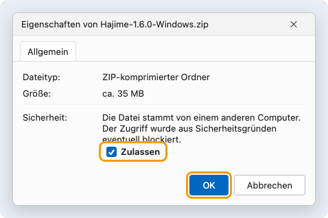
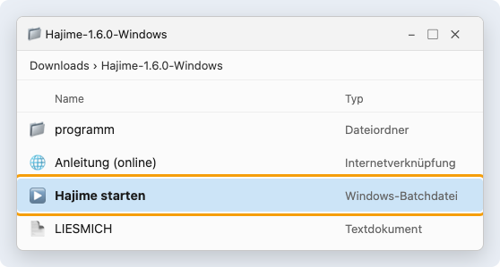

# Hajime – Schnellstart

In fünf Minuten zur Judo-Anzeigetafel. Mehr steht im [Benutzerhandbuch](benutzerhandbuch.md).

**Du brauchst:** einen Laptop und einen Beamer, Fernseher oder zweiten Bildschirm (per HDMI angeschlossen). Kein Internet, keine Anmeldung, keine Installation.

## 1. Herunterladen

Unter **[Releases](https://github.com/junky84/hajime/releases/latest)** bei „Assets“ die passende Datei laden:

| Dein Rechner | Datei |
|---|---|
| Windows | `Hajime-x.y.z-Windows.zip` |
| Mac | `Hajime-x.y.z-Mac.zip` |
| anderer Rechner mit Chrome oder Edge | `Hajime-x.y.z-Web.zip` |

## 2. Entpacken und starten

### Windows

1. Rechte Maustaste auf die ZIP-Datei → **Eigenschaften** → **Zulassen** anhaken → **OK**.

   

2. Rechte Maustaste auf die ZIP-Datei → **Alle extrahieren …** → **Extrahieren**.
3. Im neuen Ordner doppelt auf **Hajime starten** klicken.

   

Hajime öffnet sich in einem eigenen Fenster. Beim nächsten Mal genügt Schritt 3.

### Mac

`Hajime.app` doppelklicken. Beim allerersten Mal: *Systemeinstellungen → Datenschutz & Sicherheit → Dennoch öffnen*.

### Webversion

ZIP entpacken, **Hajime starten.html** mit Chrome oder Edge öffnen.

*(Die Bilder von Windows sind vereinfachte Darstellungen.)*

## 3. „Einfach“ wählen

Beim ersten Start fragt Hajime, wie du es nutzen möchtest. Für eine Anzeigetafel: **Einfach**.

## 4. Anzeige auf den Beamer

- Den Beamer auf **Erweitern** stellen: Windows `Windows` + `P` → *Erweitern*; Mac *Systemeinstellungen → Displays*.
- **Mac:** Die Anzeige erscheint von selbst auf dem Beamer.
- **Windows / Webversion:** oben rechts **Anzeige öffnen** → bei der Frage *Fenster auf allen Bildschirmen verwalten* **Zulassen**. Dann **einmal in die Anzeige klicken** (sonst kein Gong) und **doppelklicken** für Vollbild.

| Auf dem Laptop | Auf dem Beamer |
|---|---|
|  |  |

## 5. Kämpfen

1. Oben das **Regelprofil** wählen (z. B. *U13*) – das stellt die Kampfzeit ein.
2. **Leertaste** = Hajime, nochmal Leertaste = Mate.
3. Wertungen mit der Maus oder per Taste:

| | Ippon | Waza-ari | Yuko | Shido | Osaekomi |
|---|---|---|---|---|---|
| **Weiß** | `Q` | `W` | `E` | `R` | `A` |
| **Blau** | `U` | `I` | `O` | `P` | `L` |

4. Vertippt? **Rückgängig** – `Strg` + `Z` (Mac: `⌘` + `Z`).
5. Nach dem Kampf: **Kampf neu** oder **Nächster Kampf** (`N`).

Hajime macht den Rest selbst: Osaekomi-Wertung, 2 × Waza-ari = Ippon, 3. Shido = Hansoku-make, Golden Score, Gong. Alles wird laufend gespeichert.

## Wie geht es weiter?

| Du möchtest … | Im Handbuch |
|---|---|
| Namen anzeigen, Kampfliste aus Excel | [Namen und Kampfliste](benutzerhandbuch.md#namen-und-kampfliste) |
| Randori-Uhr fürs Training | [Training](benutzerhandbuch.md#training) |
| Mannschaftskampf (Liga) | [Mannschaftskampf](benutzerhandbuch.md#mannschaftskampf) |
| ein Turnier mit Gruppen, Tabellen und Urkunden | [Turnier](benutzerhandbuch.md#turnier-systeme-matten-aufruf-ruhezeit) und [Auswertung](benutzerhandbuch.md#auswertung-und-siegerehrung) |
| mehrere Matten verbinden | [Mehrere Matten im Netz](benutzerhandbuch.md#mehrere-matten-im-netz-verbinden) |
| ein Problem lösen | [Wenn etwas nicht klappt](benutzerhandbuch.md#wenn-etwas-nicht-klappt) |
